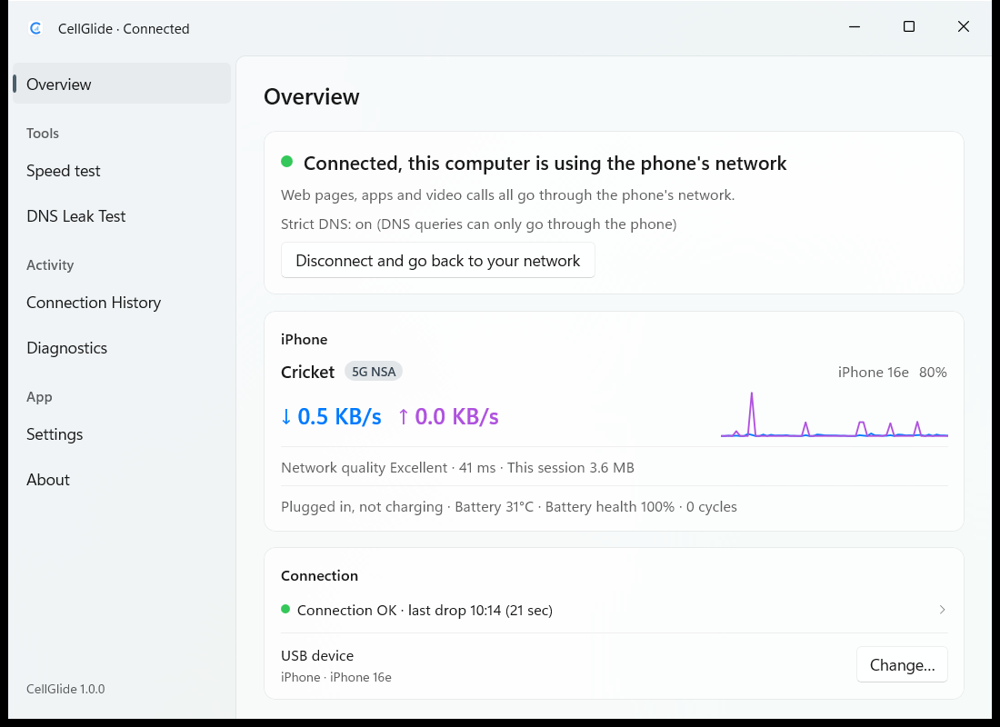
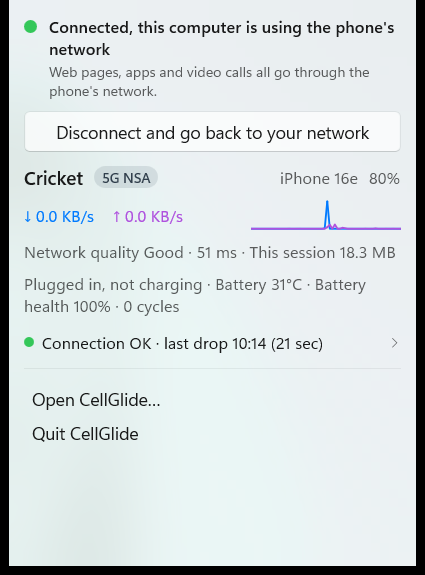
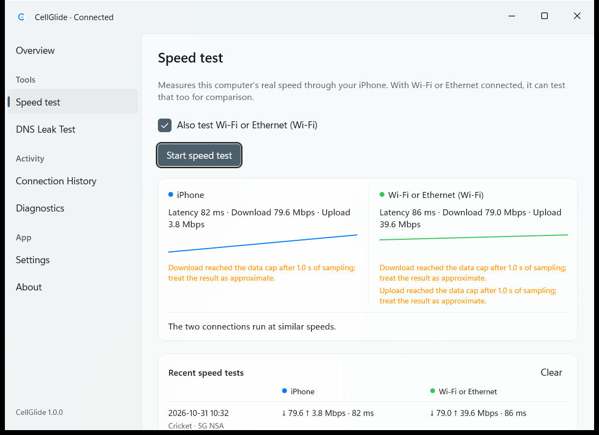
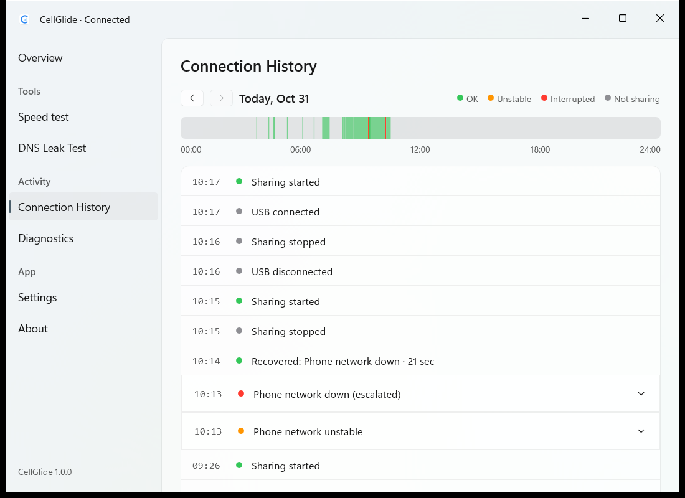
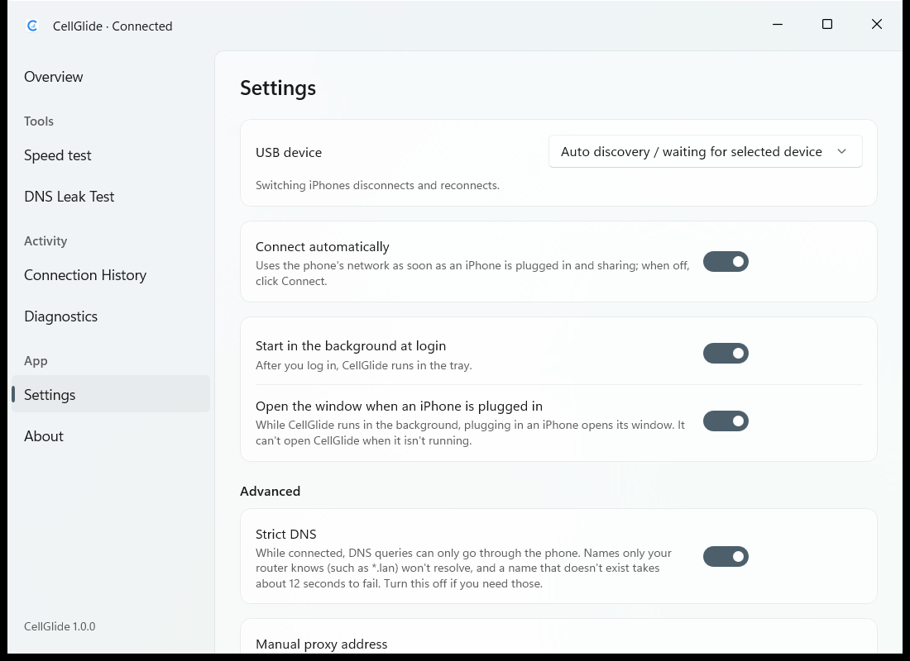
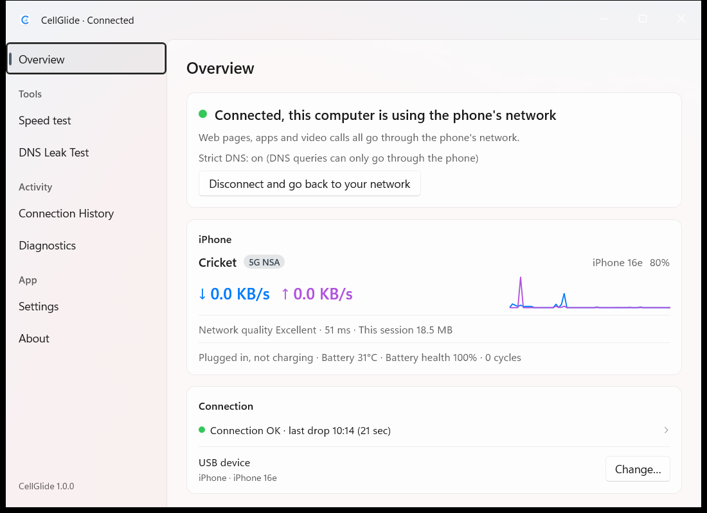
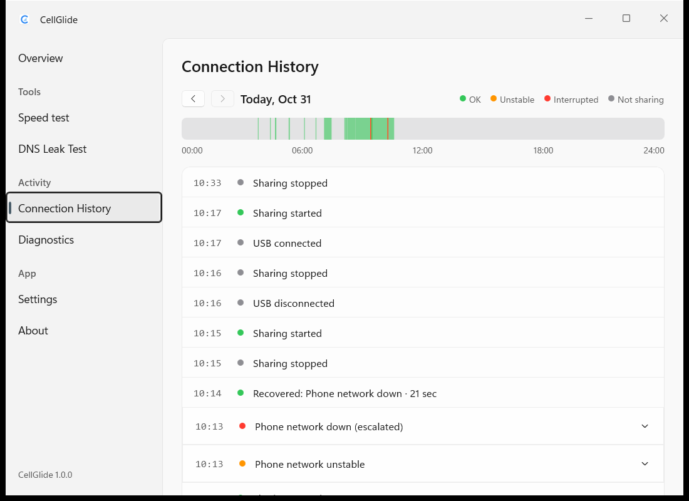

# Windows 1.0 W1 验证记录

机器：Windows 11 专业版 23H2 (22631) x64，管理员账户（提权不弹窗）。日期：2026-10-30。

## 开发用安装脚本（Task 14 Step 1）

脚本：`scripts\install-dev.ps1`，需要管理员 PowerShell：

```powershell
powershell -NoProfile -ExecutionPolicy Bypass -File scripts\install-dev.ps1 [-Release]
powershell -NoProfile -ExecutionPolicy Bypass -File scripts\install-dev.ps1 -Uninstall [-Purge]
```

### 安装做了什么

1. `cargo build [--release] -p cg-service -p cg-cli`，`fetch-wintun.ps1 -Dest target\<profile>`。
2. 停止已有的 CellGlide 服务，等 `cellglide0` 消失（最多 10 秒，超时则失败）。
3. 复制 `cellglide-service.exe`、`cellglide.exe`、`wintun.dll`、`wintun-LICENSE.txt` 到 `C:\Program Files\CellGlide\`。
4. 新建服务（`New-Service`，路径带引号，自动启动，LocalSystem）；服务已存在时用 `Win32_Service.Change` 更新路径（不用 `sc.exe config`：Windows PowerShell 5.1 传参时会丢掉 `binPath=` 里的引号，留下带空格的无引号路径）。
5. `sc.exe failure CellGlide reset= 86400 actions= restart/2000/restart/5000/restart/30000`；`sc.exe sidtype CellGlide unrestricted`。
6. `sc.exe privs CellGlide SeChangeNotifyPrivilege/SeImpersonatePrivilege/SeLoadDriverPrivilege/SeCreateGlobalPrivilege/SeAuditPrivilege`（Step 3 实测的最小集合，见文末）。
7. 建 `C:\ProgramData\CellGlide\{health,logs}`：先把所有者设为 Administrators 并 `/reset`（防止普通用户预先建好的目录残留权限），根目录 `/inheritance:r`，SYSTEM 和 Administrators 完全控制，`NT SERVICE\CellGlide` 修改；`health\` 另给 Users 读取；`logs\` 只有继承来的三项（Users 无任何权限）。
8. `Start-Service CellGlide`，等到 Running。

### 卸载做了什么（尽力而为，可重复运行）

停服务 → 等 `cellglide0` 消失（≤10 秒）→ `sc.exe delete CellGlide` → 删 `C:\Program Files\CellGlide\` → 删 `Tcpip` / `Tcpip6` 下 `Interfaces\{E490EEF2-2CB0-4A80-B341-BF929C2E56B3}` → 如有 non-present 的 `SWD\Wintun\{E490EEF2-...}` 设备（崩溃留下的 CM_PROB_PHANTOM），`pnputil /remove-device` 删除 → 保留 `C:\ProgramData\CellGlide\`（`-Purge` 时删除）。某一步失败只警告，最后退出码 1。

### 结果

安装后：

- `Get-Service CellGlide`：Running，Automatic；`sc.exe qc`：`BINARY_PATH_NAME : "C:\Program Files\CellGlide\cellglide-service.exe"`，`SERVICE_START_NAME : LocalSystem`；`qfailure` 三次重启 2/5/30 秒，重置 86400 秒；`qsidtype`：UNRESTRICTED；`qprivs`：空（默认）。
- `cellglide.exe status`：`No iPhone connected`（没插手机，符合预期），退出码 0。
- `cellglide.exe doctor`：6 项检查，5 项通过，"No iPhone is plugged in" 未通过（没插手机），退出码 1。
- 服务日志：`C:\ProgramData\CellGlide\logs\service.log.2026-10-30`，内容 `cellglide-service ready on \\.\pipe\cellglide-control`。

ACL（icacls）：

```
C:\ProgramData\CellGlide NT SERVICE\CellGlide:(OI)(CI)(M)
                         BUILTIN\Administrators:(OI)(CI)(F)
                         NT AUTHORITY\SYSTEM:(OI)(CI)(F)
C:\ProgramData\CellGlide\health BUILTIN\Users:(OI)(CI)(RX)
                                NT SERVICE\CellGlide:(I)(OI)(CI)(M)
                                BUILTIN\Administrators:(I)(OI)(CI)(F)
                                NT AUTHORITY\SYSTEM:(I)(OI)(CI)(F)
C:\ProgramData\CellGlide\logs NT SERVICE\CellGlide:(I)(OI)(CI)(M)
                              BUILTIN\Administrators:(I)(OI)(CI)(F)
                              NT AUTHORITY\SYSTEM:(I)(OI)(CI)(F)
```

轮次与快照（`scripts\network-snapshot.ps1`，`cellglide0` 及其 GUID 不参与比较）：

| 轮次 | 操作 | 结果 |
| --- | --- | --- |
| A1 | 安装（debug）→ 卸载 | 两次都成功；与基线 A 比较有差异，见下 |
| A2 | 安装 → 再次安装（更新路径）→ 人为制造 phantom 设备 → 卸载 | 成功；phantom 设备被删除 |
| A3 | 安装（`-Release`）→ `-Uninstall -Purge` → 干净机器上再 `-Uninstall` | 都成功（退出码 0），数据目录已删除 |
| B | 新基线 B → 安装 → 卸载 → 安装 → `-Uninstall -Purge` | 安装后、第一次卸载后、最后卸载后与基线 B 比较都是 `identical` |

A 轮的差异都来自局域网，与 CellGlide 无关（服务没有创建网卡，没插手机）：

- Wi-Fi 上新增 `fd55:ab04:2c04:48cc::/64` 及两个地址：来源 RouterAdvertisement，生命期约 29 分钟，是局域网里的路由通告。
- Wi-Fi 的 `Tcpip6\...\Dhcpv6InterfaceOptions` 变化：把 4 字节时间戳屏蔽后内容完全相同；记录里 T1 = 0x546 = 1350 秒，上次续租 10:14:00Z + 1350 秒 = 10:36:30Z，正是这次的新时间戳，即 DHCPv6 按 T1 定时续租。快照脚本的易变值正则没有覆盖这个值。

`scripts\tests\test-network-snapshot.ps1`：`all passed`。

最终状态：服务、程序目录、数据目录、`cellglide0`、phantom 设备、Tcpip 接口键都不存在。

其他观察：服务启动时 `cleanup_leftovers` 清理我们 GUID 的 DNS，会重新建出 `Tcpip\...\Interfaces\{E490EEF2-...}` 键（只属于 cellglide0，快照不比较），卸载时删除。

## 实机端到端（Task 14 Step 2）

手机：iPhone 16e（iPhone17,5），iOS 26.6，App Store 版 CellGlide 2.4.0，Cricket（AT&T 网络）5G NSA，USB 接 Apple 设备应用（AMDS，127.0.0.1:27015）。电脑：Wi-Fi（出口 `172.58.116.225`）、Tailscale（Up）、蓝牙 PAN（未连接）。安装：`scripts\install-dev.ps1 -Release`。

基线快照在安装之前拍（`target\t14b\snap-0-baseline.json`，08:40 本地）；安装后、手机还没共享时与基线比较 `identical`。手机 App 未共享时服务按退避重试，日志为 `connect failed: phone service not ready`（usbmuxd 拒绝连 App 的 8088 端口），用户在手机上开始共享后服务自动连上。

快照差异说明：08:51 前后 Wi-Fi 的 DHCPv6 按 T1 续租，`Tcpip6\{f870e3e0-...}\Dhcpv6InterfaceOptions` 里 4 字节时间戳从 `7c60e56a` 变成 `c265e56a`（相差 0x546 = 1350 秒，正好是 T1），把时间戳屏蔽后两个值完全相同（与 Step 1 A 轮的现象一样，快照脚本的易变值正则没覆盖这个值）。所以续租之后的快照既和基线比，也和续租后第一张断开状态快照（`snap-4-afterkill.json`）比；除这一个值外都 `identical`。

### 1. 连接、出口、DNS —— 通过

- `cellglide.exe status`：`Connected. This computer is using the phone's network (CellGlide 2.4.0 on the phone)` / `Cricket · 5G NSA · iPhone 16e · 79% (charging)` / `Connection OK`。
- `curl.exe -s https://www.cloudflare.com/cdn-cgi/trace`：`ip=2600:387:15:1339::4`（IPv6）；`curl.exe -4`：`ip=166.194.147.76`。两个都是 AT&T Mobility 的地址（Cricket 走 AT&T），不是 Wi-Fi 的 `172.58.116.225`。
- `Resolve-DnsName example.com`：成功（A `104.20.23.154`、`172.66.147.243`，AAAA 两条）。
- `Get-DnsClientServerAddress -InterfaceAlias cellglide0`：IPv4 `{198.18.0.1}`，IPv6 `{}`。
- cellglide0：地址 `198.18.0.1/32`、`fd6c:6779:6465::1/128`，MTU 1500，路由 `0.0.0.0/1`、`128.0.0.0/1`、`::/1`、`8000::/1`（跃点 0）。
- 严格 DNS：服务日志 `INFO cg_platform::windows::backend: strict DNS on: port 53 only through cellglide0`，之后每次连接都有这一行。

### 2. 物理网卡上的 DNS 包 —— 通过（0 个）

`pktmon filter add -p 53`，`pktmon start --capture --comp 12 13 1`（蓝牙 PAN、Wi-Fi AX201，另加 Tailscale），60 秒（08:49:34–08:50:36）里循环访问 20 个网站：55 次 HTTPS 请求（49 次 2xx/3xx），每 20 次清一次 DNS 缓存，每次另做一次 `Resolve-DnsName -DnsOnly`。停止前 `pktmon counters`：`All counters are zero`，即 Wi-Fi、蓝牙、Tailscale 上 0 个 53 端口的包。

对照：随后把过滤器换成 443/41641 端口抓 5 秒，Wi-Fi 上计到 Rx 11 / Tx 10 个包，说明抓包本身是有效的。

### 3. 断开 —— 通过

`cellglide.exe disconnect` → `Disconnected. This computer is back on its own network`，0.83 秒后 cellglide0 消失；`status`：`iPhone connected. Run cellglide connect to use the phone's network`。快照（`snap-3-disconnected.json`）与基线 `identical`。

### 4. 服务被强杀 —— 通过

连接后 `taskkill /F /IM cellglide-service.exe`（PID 12480），每 100 ms 轮询：

| 事件 | 距 taskkill |
| --- | --- |
| cellglide0 消失 | 0.08 秒 |
| 四条 /1 路由消失 | 0.08 秒 |
| SCM 拉起新进程（PID 7156） | 2.06 秒 |
| 自动连接，cellglide0 重新 Up | 2.98 秒 |

系统日志 7031：`The CellGlide service terminated unexpectedly. It has done this 1 time(s). The following corrective action will be taken in 2000 milliseconds: Restart the service.` 重连后出口仍是 `166.194.147.76`，DNS 仍只有 `198.18.0.1`，日志有 `strict DNS on`。没有留下 phantom 设备。断开后快照（`snap-4-afterkill.json`）与基线只差上面说明的 DHCPv6 续租时间戳。

### 5. 拔线 / 插回

**通过，有附注**（2026-10-30，用户在场）。注意：用户执行过 `disconnect` 后，`user_disconnected` 会写进设置，自动连接要等下一次 `connect` 才恢复；测之前先 `cellglide.exe connect` 了一次。

- 拔线：16:15:51Z 健康检查报 `NoUsbService`，会话释放，cellglide0 消失，`status` 显示 `No iPhone connected`。
- 第一次插回：PnP 里 iPhone 正常（`VID_05AC&PID_12A8`），但 Apple 设备的 usbmuxd `ListDevices` 返回空列表（原始查询和 `phone_probe` 都是），手机上显示 USB 只在充电。CellGlide 按退避重试（日志写 `usbmuxd not reachable`，这个措辞对「端口在、但没有设备」的情况不准，待改）。系统日志显示 16:15:01Z–16:22:19Z 机器处于现代待机，和这次拔插重叠，很可能是原因。
- 第二次插回：usbmuxd 列出手机，16:24:54Z 自动连接，严格 DNS 重新开启。

### 6. 睡眠 / 唤醒

**部分通过，发现问题**（2026-10-30，用户在场）。

- 这台机器只支持现代待机（`powercfg /a`：Standby (S0 Low Power Idle) Network Connected）。brief 里的 `rundll32.exe powrprof.dll,SetSuspendState 0,1,0` 被系统拒绝（Kernel-Power 187），机器没有睡下去。
- 改为用户短按电源键：16:28:11Z 进入、16:28:23Z 退出现代待机。连接保持不断，唤醒后 `status` 仍为已连接；日志只有一条「battery details unavailable」。
- **问题**：两次现代待机（上面这次和第 5 项期间 16:15–16:22 的那次）服务日志里都没有 Suspend / Resume 事件，也没有墙钟跳变记录。现在的电源处理只覆盖 S3 睡眠（`PBT_APMSUSPEND` / `PBT_APMRESUMEAUTOMATIC`）。现代待机要另外处理（例如注册 `GUID_CONSOLE_DISPLAY_STATE` 的 `PBT_POWERSETTINGCHANGE`，退出待机时按唤醒处理、立即重新探测手机），列入后续任务。传统 S3 睡眠这台机器测不了。

### 7. 诊断包 —— 通过

`cellglide.exe diagnostics --save target\diag.json` → `Saved to target\diag.json`，exit 0，3193 字节。不区分大小写搜索：Windows 用户名（`$env:USERNAME`）0 处，计算机名（`$env:COMPUTERNAME`）0 处。内容：`app 1.0.0`、`platform windows`、`os "Windows 11 Pro 23H2 (build 22631)"`、`environment`（检查项全部 ok、State `connected (phone 2.4.0, dns phone)`、Phone `AT&T · 5G NSA`）、`sessions` 1 条、`timeline` 10 条、`log` 14 行服务日志（`cellglide-service ready ...`、`strict DNS on ...` 等）。

### 8. 测速（只跑了一次完整测速）—— 下行有数，上行 0.0

`speed/transport.rs` 原来只在 Linux 上能绑网卡，第一次 `speedtest -y` 0.7 秒就失败了：`Could not find this network interface. Check Wi‑Fi and try again`（没有发出任何测速流量）。补上 Windows 的 `IP_UNICAST_IF` / `IPV6_UNICAST_IF` 绑定后（提交 `f081474`），只跑了**一次**完整测速（08:56:26 开始，20.9 秒，exit 0）：

```
iPhone
  Latency 139 ms · Download 195.4 Mbps · Upload 0.0 Mbps
Speed test finished
```

- 测速期间每秒采样 cellglide-service 的 CPU（`TotalProcessorTime`，共 25 个样本）：峰值约 0.39% 总 CPU（8 个逻辑处理器，约合 3.1% 单核），工作集 32–39 MB。服务进程从 08:56:09 启动到测完一共只用了 0.36 秒 CPU，这期间 cellglide0 收 227 MB、发 56 MB。另外用 curl 下载 20 MB 做了对照：服务 CPU 只增加 0.06 秒，cellglide0 收到 20.9 MB。
- **上行 0.0 Mbps**：上传期间系统往 cellglide0 写了约 50 MB，但测速结束后手机端 `↑` 还以约 460–590 KB/s 持续发了约 3.5 分钟，`Network quality` 降到 Poor（857–1267 ms），09:00:15 才降到 0。说明大量上传数据积压在电脑之外（netstack 每条连接只有 256 KB 缓冲，积压应该在 usbmux 或手机那一侧），而测速引擎是按套接字收下的字节算上行，预热 2 秒之后几乎没有新字节被收下。积压排空后，用 curl 往 `speed.cloudflare.com/__up` 传了 5 MB：12.0 秒，约 3.3 Mbps。这条线路的上行实际只有几 Mbps；测速数字为 0 这件事留给 W2 查，**没有**重跑测速。
- 本次会话手机一共计了约 340 MB。

## 最小特权集合（Task 14 Step 3）—— 这组特权可用，已写进脚本

`sc.exe privs CellGlide SeChangeNotifyPrivilege/SeImpersonatePrivilege/SeLoadDriverPrivilege/SeCreateGlobalPrivilege/SeAuditPrivilege`，`Restart-Service`。读取服务进程令牌（`GetTokenInformation(TokenPrivileges)`），里面正好是这 5 项（SeLoadDriverPrivilege 存在但未启用，其余 4 项已启用）。

- 第 1 项：重启 2.3 秒后自动连上；出口 `166.194.147.76` / `2600:387:15:1339::4`；`example.com` 能解析；cellglide0 DNS 只有 `198.18.0.1`；四条 /1 路由都在；日志有 `strict DNS on`（WFP 动态会话正常）。
- 第 3 项：`disconnect` 后 1.26 秒网卡消失；快照与续租后的 `snap-4` 比 `identical`。
- 另外又做了一次第 4 项：`taskkill` 后 0.10 秒网卡消失；这是 24 小时内第二次失败，SCM 按 5 秒延迟在 5.13 秒拉起服务，5.93 秒重新 Up；`doctor` 7 项全部通过（exit 0）；断开后快照与 `snap-4` 比 `identical`。

`install-dev.ps1` 现在会设置这组特权。用改过的脚本重装后：`sc qprivs` 是这 5 项，`qc` 路径带引号，自动启动，LocalSystem，`qfailure` 为 2/5/30 秒、重置 86400 秒，`qsidtype` 为 UNRESTRICTED。

最终状态（09:06）：服务已安装、Running，隧道断开（`user_disconnected`），没有 cellglide0，没有 phantom 设备；快照与基线只差 DHCPv6 续租时间戳，与 `snap-4` 比 `identical`。

## 上行 0.0 调查（W2 Task 4，2026-10-30）

工具：`cargo run -p cg-tools --example speed_probe -- --route phone --down-mb 5 --up-mb 5 --seconds 5`（小数据量探针），同时每秒 `cellglide.exe status` 看手机卡片的 `↑`。这天手机（Cricket 5G NSA）上行比 W1 快得多：curl 往 `__up` 传 5 MB 用 2.02 秒，**19.8 Mbps**（W1 是 3.3 Mbps）。服务里临时加了计数（查完已删）：② cg-netstack 每条会话写给 SOCKS 的字节（`tcp.rs` 的 `uplink`），③ 转发器写进 usbmux 连接的字节（`copy_bidirectional` 临时换成计数拷贝），另外记下手机那一侧何时回 EOF。

- **复现（修改前）**：6 条流各 833 KB，① 引擎在 0.5 秒的第一个 tick 就算完 5 MB（cap reached），报上行 **79.3 Mbps**；② 每条 835,277 字节在 85–91 ms 内全部交给 SOCKS；③ 转发器在 152–157 ms 内全部写进 usbmux；**手机在 0.3–0.4 秒后就回了 EOF**（说明我们的数据和 FIN 都已到手机），可手机 `↑` 之后还以 2.15–2.50 MB/s 持续约 3 秒。单流 10 MB、1 秒（时间到才结束）：② 0.44 秒写完 10 MB，③ 0.15 秒 4.3 MB、0.49 秒 7.0 MB、1.99 秒 10 MB（这里有约 3 MB 暂时在 netstack→转发器的本机回环套接字里），手机 2.7 秒时回 EOF，`↑` 又持续约 2 秒（约 5 MB 在手机里）；引擎报 79 Mbps，手机实际约 20 Mbps。W1 那次是 6 × 50 MB 的大请求、10 秒，积压约 50 MB，在 3.3 Mbps 的上行上排了几分钟，而引擎 2 秒预热之后几乎没有新字节被套接字收下，所以是 0.0。
- **积压在哪**：在我们进程之外，主要在手机里。②≈③（同一批字节，几十毫秒之差），③ 远大于手机实际 `↑`，但手机已经读完了数据和 FIN（回了 EOF）还在往蜂窝发，说明是手机自己的发送缓冲（iOS 那一侧）在排队；收紧我们这边的缓冲（`SOCKET_BUFFER`、转发器的 `SO_SNDBUF`）挡不住手机吃下几 MB 到几十 MB。
- **测速结束后 cg-netstack 对 SOCKS 一侧**：修改前是**发 FIN**（客户端 RST 后会话被清理，流任务按 `End::Gone` 正常关闭），转发器把 FIN 传给手机，手机把手里的数据发完。W1 终审 T9 遗留的 TIME-WAIT 情形（同一四元组复用时带着未读数据的会话被清掉）走的也是这条路，误报成正常结束。
- **修法：做法 B**（理由：积压在手机，只能改计量，不能靠收紧我们这边的缓冲）。引擎按服务器确认的字节计上行：上传请求一律 `UPLOAD_REQUEST`（1 MB，`Params.request_size` 只管下载），一个请求收到 `__up` 的 200 回复才把它的字节计入，同一连接上一个接一个发；上传套接字设 `SO_LINGER 0`，测完关闭时发 RST，缓冲里剩下的不再发出。cg-netstack 在客户端没发 FIN 就消失时（RST、会话被清理）向 SOCKS **中止**（零 linger），转发器随之丢掉 usbmux 连接；只有服务停止时才正常关闭。所有平台同一算法，Linux 同样生效。
- **修改后实机（小数据量）**：同一命令跑两次，上行 **19.8 Mbps**、**66.2 Mbps**；curl 对照 **19.8 Mbps**。第二次偏高是小上限的量化问题：每条流只有一个 833 KB 的请求，6 个确认挤在 2.0–2.5 秒之间，预热点（2.0 秒）之后 0.5 秒内算进了 4.2 MB；第一次的确认都在 2.0 秒之前到，算出的是从头平均。另跑一次每条流 5 个请求（`--streams 2 --up-mb 10 --down-mb 2 --seconds 5`）：**23.8 Mbps**，手机 `↑` 当时 1.9–3.5 MB/s。测完后手机 `↑` 1–2 秒内回到 0（3 次都是）。时间到才结束的单流 1 秒（`--up-mb 10 --seconds 1 --streams 1`）：引擎只算已确认的 1 MB（7.9 Mbps），关闭时转发器那条连接以错误结束（SOCKS 一侧被中止），手机 `↑` 约 3 秒内回到 0，剩下的不到 1 MB 是手机已经收下的。下行 26.4 Mbps（两次）、15.8 Mbps，和 W1 同量级（W1 是完整测速 195 Mbps，这里每条流不到 1 MB，主要量的是慢启动）。
- **手机流量（第一轮）**：**63.0 MB**（`This session` 从 26.2 MB 到断开时的 89.2 MB）。其中修改前 2 次探针加后台流量 22.1 MB；修改后 4 次探针加 curl 5 MB，共 40.5 MB；最后 0.4 MB 是重装、断开期间的后台流量。
- 网络快照：当天新拍基线，装服务、连接、测量、断开之后再拍，`-Compare` 结果 `identical`。
- **评审后修正（fix round 1）**：上面第二次的 66.2 Mbps 和慢上行的问题都修了，只改上传方向：
  - 预热后确认的请求少于 2 × 流数，或者阶段因为达到上限而结束时，上行按从阶段开始算的平均：`mbps(moved, elapsed)`。
  - 时间到了还没有足够的确认时，不再发新请求，给已经在路上的请求一个宽限期等确认，最多再等一个 `duration`（默认 10 秒）。这时速率 = 已确认字节 ÷ 最后一次确认的时间。宽限期内一个确认都没有，上行就不给数字（`None`），并加一条说明（`speed.upload_too_slow`），不再显示 0.0。
  - 宽限期里进度事件照常发出，`elapsed` 停在 `duration`，不会倒计时到负数。
  - 预热后确认够多时，仍用 Mac 的预热后速率。
  - 在 W1 那样 3.3 Mbps 的上行上，第一批确认约 14.5 秒才到，现在落在宽限期内，算出约 3.3 Mbps。
- **修正后实机复测**（服务已重装；当天新拍快照，前后 `identical`）：同一命令跑两次，上行 **19.7 Mbps**、**26.4 Mbps**；curl 对照 **24.4 Mbps**（5 MB，1.64 秒）。两次都在 ±50% 内（−19%、+8%）。下行 26.5 Mbps 两次。测完后手机 `↑` 约 1 秒内回到 0。这一轮用了 **25.3 MB**（89.2 → 114.5 MB）。本任务两轮合计 **88.3 MB**。

## 严格 DNS 开关（W2 Task 7，2026-10-30）

设置里多了一个开关 `strict_dns`（默认开；旧的 settings.json 读出来也是开）。命令行：`cellglide settings --strict-dns on|off`，`cellglide settings` 在 Windows 上多打一行「严格 DNS：开/关」。连接中切换立即生效，不重连：关 = 关闭 WFP 动态会话（我们的子层和全部过滤器随之删除）；开 = 按连接时同样的条件（cellglide0 的 DNS 设置成功）重新建会话，虚拟网卡的 LUID 放行重新枚举。关闭时 `status` 显示「严格 DNS：已在设置中关闭」，诊断写 `StrictDns: disabled`，不记时间线事件；打开失败照旧记 `strictDnsUnavailable`。设置为关时连接，不建 WFP 会话。

实机（release 服务重装，iPhone 16e / Cricket 5G NSA，Wi-Fi DNS `10.10.10.1`）：

| 步骤 | `status` | 诊断 `StrictDns` | `netsh wfp show filters`/`show state`（只读） | pktmon，Wi-Fi 网卡，端口 53，20 秒 | `Resolve-DnsName example.com -Server 10.10.10.1` |
| --- | --- | --- | --- | --- | --- |
| 连接后（默认开） | 严格 DNS：已开启 | `on` | 子层在，18 个过滤器 | 0 包（3 轮查询，全部超时） | 超时 |
| `--strict-dns off` | 严格 DNS：已在设置中关闭 | `disabled` | 子层不在，0 个过滤器 | **266 包**（Rx 130 / Tx 136；32 轮，32 次直接查询都有应答） | 有应答 |
| `--strict-dns on` | 严格 DNS：已开启 | `on` | 子层在，18 个过滤器，与第一次逐条相同 | **0 包**（3 轮，全部超时） | 超时 |
| 断开 | 已断开 | — | 子层不在，0 个过滤器 | — | — |

- 18 个过滤器 = 两层（`ALE_AUTH_CONNECT_V4/V6`）各：1 个按接口类型 6/71/243/244 拦 53 端口、6 个虚拟网卡 LUID 放行、1 个回环放行、1 个 cellglide0 LUID 放行。重新打开后按层、动作、权重、条件比较，与连接时的那份完全一样（过滤器 ID 不同）。
- 网络快照：重装服务前新拍基线，连接、两次切换、断开之后再拍，`-Compare` 结果 `identical`。特权测试（含新加的 `strict_dns_toggles_on_a_running_tunnel`、`strict_dns_off_in_the_plan_starts_without_rules`）前后也是 `identical`。
- 结束时设置恢复默认（严格 DNS 开），隧道已断开；pktmon 过滤器列表清空（开始前也是空的）。
- 不测速。手机流量约 0.3 MB（`This session` 242 KB，加上断开前的少量后台流量）。

## W2 cellglide_native.dll（W2 Task 13，2026-10-30）

工具：`windows/CellGlide.Probe`（控制台小程序，经 CellGlide.Core 的 `NativeCore` + `EventHub` + `InlineDispatcher` 调 `cellglide_native.dll`），在 `windows\` 里运行：`dotnet run --project CellGlide.Probe -- status|speed-small|leak`。每行是「时间 + 事件名 + DLL 给的文字」，程序自己只写用法说明。环境：iPhone 16e / Cricket 5G NSA，Wi‑Fi 对比网卡，debug 服务用 `scripts\install-dev.ps1` 重装为当前 HEAD。

| 项目 | 结果 |
| --- | --- |
| 1. `status --seconds 60`，期间 `Restart-Service CellGlide`（23:10:34.7 发出，0.6 秒返回） | **通过**。23:10:34.847 `service_gone`「The CellGlide service stopped」；23:10:36.857 恢复 `state`（Waiting for USB → Checking the phone's exit），同时 `phone_plugged 00008140-…`；23:10:37.398 「Connected, this computer is using the phone's network」+「Strict DNS: on (DNS queries can only go through the phone)」，手机卡片「Cricket · 5G NSA」。服务停到恢复连接约 2.6 秒，C# 没有重新订阅。退出码 0。 |
| 2. `speed-small`（caps 下行 10 MB、上行 5 MB、5 秒，include_wifi，confirmed） | **通过**。iPhone 腿 Done：延迟 119 ms、下行 **39.7 Mbps**、上行 **1.6 Mbps**（经过宽限期「Waiting for the server to confirm the upload…」后确认，不是 0.0）；Wi‑Fi 腿 Done：79 ms、下行 **78.6 Mbps**、上行 **39.5 Mbps**。verdict「Wi‑Fi download is 2.0x faster than the iPhone.」，历史最新一条 `2026-10-30 23:11 | ↓ 39.7 ↑ 1.6 Mbps · 119 ms | ↓ 78.6 ↑ 39.5 Mbps · 79 ms | Cricket · 5G NSA`。各腿带 cap reached 的说明。退出码 0。手机流量：`This session` 257 KB → 12.3 MB，约 **12.0 MB**。 |
| 3. `leak` | **通过**。leakcheck 服务端接受 Windows 客户端（未出现 `leak.unavailable`）。结论「No leak」：全部查询经 Cloudflare 加密 DNS（1 组 16 个地址），出口「AT&T Enterprises, LLC · Arizona, US」。退出码 0，流量不到 0.1 MB。 |
| 4. `cellglide.exe disconnect` 后拍快照 | **`identical`**（基线在重装服务之前新拍：`target\t13\snap-before.json`，之后 `snap-after.json`）。 |
| 5. Release：`cargo build -p cg-ffi --release`；`dotnet run -c Release -p:CellGlideNativeDir=..\..\target\release\ --project CellGlide.Probe -- status --seconds 10` | **通过**。打印「Disconnected」状态，退出码 0；输出目录里的 DLL 与 `target\release\cellglide_native.dll` 哈希相同。当时相对路径按各项目目录解析，所以写成 `..\..\target\…`；fix round 1 之后相对路径一律从 `windows` 目录算起，写 `..\target\release\` 即可（Debug、Release 下都核对过 DLL 哈希）。 |
| ARM64（只编不跑） | `cargo build -p cg-ffi --target aarch64-pc-windows-msvc` 成功；`dotnet build CellGlide.Core -c Debug -r win-arm64` 成功、0 警告；`dotnet publish CellGlide.Probe -c Release -r win-arm64 --self-contained false` 成功，`CellGlide.Probe.exe` 和 `cellglide_native.dll` 都是 ARM64 PE。锁文件不变（`Directory.Build.props` 的 `RuntimeIdentifiers` 是 `win-x64;win-arm64`，两个 RID 都记在锁文件里）。 |

- 观察：小测速时 iPhone 腿的阶段文字刚进上行时有一帧「Testing Upload… 2 / 10 s」再回到「1 / 10 s」，以及 caps 下仍写「/ 10 s」，都是 Task 10 已记下的阶段文字问题，不影响结果。
- 结束时：隧道已断开，服务 Running。
- **手机流量**：本任务约 **12.6 MB**（重启前的会话约 0.2 MB，重启后的会话到断开 12.4 MB）。**W2 累计约 111 MB**（预算 300 MB）。W2 没有跑过完整测速。
- **Ctrl+C（fix round 1）**：Probe 处理 `Console.CancelKeyPress`（`e.Cancel = true`，退回 `ProcessExit` 兜底），信号一到：正在跑的测试先发 `SpeedCancel`/`LeakCancel`，所有等待都结束，`using` 照常释放，所以总会调到 `cg_shutdown`；退出码 130。实机（Probe 在单独的控制台里运行，另一个进程 `AttachConsole` + `GenerateConsoleCtrlEvent` 发 Ctrl+C）：`status` 263 ms 内退出 130；`leak` 在测试进行中（开始约 0.6 秒后）退出 130；`speed-small` 在 iPhone 腿「Checking HTTPS latency…」时收到 Ctrl+C，DLL 随即发出两条腿「Speed test cancelled」，253 ms 内退出 130，手机 `↑↓` 回到 0。这一轮快照前后 `identical`（`snap-f1-before/after.json`），隧道已断开，手机流量约 **0.1 MB**（`This session` 12.4 → 12.5 MB）。W2 累计仍约 111 MB。

## W3 界面

### 工具链与 App 骨架（W3 Task 1，2026-10-31）

- **没有装任何东西**。`dotnet build CellGlide.sln -c Debug` 只靠 NuGet 包（Microsoft.WindowsAppSDK 2.6.4、H.NotifyIcon.WinUI 2.4.1）就编过了，0 警告，不需要 VS 的 `Microsoft.VisualStudio.ComponentGroup.WindowsAppSDK.Cs` 组件。
- **Native AOT 链接要 `vswhere.exe` 在 PATH 上**。ILCompiler 调 `vcvarsall.bat`，后者按 PATH 找 `vswhere.exe`，找不到时那句报错被拼进了 link.exe 的路径，链接失败。现在 `scripts/dev-env.ps1` 会把 `%ProgramFiles(x86)%\Microsoft Visual Studio\Installer` 加进 PATH。
- **代理的 shell 在会话 0**（没有交互桌面），WinUI 在那里起不来，`Microsoft.UI.Xaml.dll` 以 0xC000027B（E_ACCESSDENIED）崩溃。界面实测改用临时计划任务（`schtasks /it /ru iloss`），在会话 1 里启动、读标题、关窗口，查完就删掉任务。
- Debug 运行：窗口标题 `CellGlide`（DLL 的 `gui.title`）；`CloseMainWindow` 后约 0.3 秒退出，退出码 0。
- **AOT 还是 R2R：用 Native AOT**。`dotnet publish CellGlide.App -c Release -r win-x64 -p:CellGlideNativeDir=..\target\release\`：0 警告（包括 H.NotifyIcon 和 System.Drawing.Icon 被实际用到时），发布出来的 `CellGlide.exe` 标题正确、关窗口约 0.3 秒退出，退出码 0。没有挡路的问题，所以不退回 ReadyToRun。
- **AOT 下的托盘（临时代码，查完已删）**：用 H.NotifyIcon `TaskbarIcon` 加一个临时 .ico，`ForceCreate` 后 `IsCreated=True`，`Shell_NotifyIconGetRect` 返回 S_OK 和任务栏上的位置（物理像素 1573,1020–1613,1080）。按 shell 点击图标时发的回调消息（NOTIFYICON_VERSION_4 的 WM_LBUTTONDOWN/UP、WM_RBUTTONDOWN/UP），`LeftClickCommand` 和 `RightClickCommand` 都被调到了。没能用眼睛确认：会话 1 截屏是全黑的（屏幕锁定或显示器关着），也没有用真鼠标点。
- **去掉 AI/ML 组件**：Microsoft.WindowsAppSDK 元包（H.NotifyIcon.WinUI 也依赖它）会带进 `.AI`、`.ML`、`.Search` 和 `Microsoft.Windows.AI.MachineLearning`，发布目录里因此多了 onnxruntime.dll（22 MB）、DirectML.dll（17.8 MB）、语义搜索的 DLL 等。App 工程直接引用这四个包，并设 `ExcludeAssets="all"`，它们的文件就不再进构建和发布。WinUI 窗口和托盘照常工作（上面两条就是在这个配置下测的）。发布目录从 158.0 MB / 294 个文件降到 102.7 MB / 242 个。
- **发布大小**：win-x64 共 102.7 MB、242 个文件，其中 pdb 27 MB，不含 pdb 75.6 MB；win-arm64 共 109.4 MB，不含 pdb 82.6 MB。
- **ARM64 只编不跑**：`cargo build -p cg-ffi --release --target aarch64-pc-windows-msvc --locked` 后 `dotnet publish CellGlide.App -c Release -r win-arm64 -p:CellGlideNativeDir=..\target\aarch64-pc-windows-msvc\release\` 成功。`CellGlide.exe` 和 `cellglide_native.dll` 的 PE Machine 都是 0xAA64，锁文件没有变化。
- **NuGet 许可**：`scripts/check-nuget-licenses.ps1` 生成 `packaging/licenses/nuget.txt`，`-Check` 已接进 `check-windows-core.ps1`。把 nuget.txt 里一个版本号改掉后，`-Check` 退出 1；删掉 `$Reviewed` 的一项后，脚本报「not in the allowed list and not reviewed」并退出 1。
  - **Windows App SDK 不是宽松许可**（控制者裁定接受）：Microsoft.WindowsAppSDK 元包和各组件包都是 Microsoft Software License Terms，Microsoft.Windows.AI.MachineLearning 是 Windows ML Runtime 的同类条款。条款 §3.a.i 允许把 NuGet 包放到应用旁边的文件随应用分发，自包含部署也算。它们记在 `$Reviewed` 里。WebView2 的许可文件是 BSD-3-Clause 文本，也记在 `$Reviewed` 里。Windows SDK BuildTools / BuildTools.MSIX 标为「build only, not shipped」。
  - **W4 必须做**：zip 和安装包要带上 Windows App SDK 的许可文本和最终用户条款提示（条款 §3.b.ii 要求分发者和最终用户同意至少同等保护微软的条款），`THIRD-PARTY-LICENSES` 也要列上它。
- `scripts\check-windows-core.ps1` 与 `-Publish` 都退出 0：115 个测试通过；`-Publish` 的发布目录里有 `CellGlide.exe` 和 `cellglide_native.dll`。

### 宿主：单实例与自启动（W3 Task 4，2026-10-31）

- **单实例**（Debug 构建，服务 Running；会话 1 的临时计划任务里运行，查完已删除任务，没有留下进程）：
  1. 第一次启动：窗口出现，标题 `CellGlide`，进程数 1。
  2. 窗口开着时再启动（不带参数）：第二个进程 121 ms 后以 0 退出；5 秒后进程数 1，窗口仍可见。
  3. 关窗口（WM_CLOSE）：窗口隐藏，进程还在；再启动一次：进程数 1，窗口重新出现（说明激活确实转给了第一个实例）。
  4. 窗口隐藏时带 `--tray` 启动：第二个进程 94 ms 后以 0 退出；5 秒后进程数 1，窗口仍隐藏。窗口可见时带 `--TRAY` 启动：同样退出，窗口不变。
  5. `Stop-Process -Name CellGlide`。
  6. 另加：第一次就以 `--tray` 启动：有进程、没有窗口；随后不带参数启动：窗口出现，进程数 1。
  - **「带到前面」没能确认**：会话 1 当时锁屏，`GetForegroundWindow` 一直是 0（连新开的 cmd 窗口也不是前台）。代码上，第二个实例先 `AllowSetForegroundWindow(第一个实例的 PID)`，第一个实例在 `Activated` 里 `AppWindow.Show()`、`Activate()`、`SetForegroundWindow`。要在屏幕解锁时再看一次（Task 10）。
- **自启动，真实的 HKCU Run 值**（临时控制台程序用 `RegistryRunKey()`、`RegistryStartupApproved()` 的默认路径，exe 路径用 `C:\Program Files\CellGlide\app\CellGlide.exe`）：测前 Run 里没有 `CellGlide`，StartupApproved\Run 里也没有；`Read()` 为 Off；`Set(true)` 后值为 `"C:\Program Files\CellGlide\app\CellGlide.exe" --tray`（REG_SZ），`Read()` 为 On；`Set(false)` 后值消失，`Read()` 为 Off；最后按测前状态恢复（没有值），比对 Run 值和 StartupApproved 值与测前一致。StartupApproved 只读，没有写过。
- **DLL 起不来（fix round 1）**：把 Debug 输出复制一份、删掉 `cellglide_native.dll` 后启动（会话 1）：弹出标题 `CellGlide` 的错误框，内容为「The CellGlide installation is incomplete. Please reinstall CellGlide.」加「CellGlide 安装不完整，请重新安装 CellGlide。」；点掉后进程以退出码 2 结束。
- **早到的转发（fix round 1）**：以 `--tray` 启动后 300 ms 就不带参数再启动一次：第二个进程以 0 退出，进程数 1，窗口出现（标题 `CellGlide`）。`Activated` 在 `Application.Start` 之前就订阅，没等到 `OnLaunched` 的转发会被记住，之后补上。

### 托盘与面板（W3 Task 5，2026-10-31）

- **图标**：`python -I scripts/gen-windows-icons.py` 生成 `windows/CellGlide.App/Assets/AppIcon.ico` 和 `Assets/Tray/cellglide-{idle,active,alert,active-alert}-{light,dark}.ico`（托盘每个 16/20/24/32/40/48 六帧，帧内容是 PNG）。`--check` 在内存里重新生成，与已提交文件逐字节比较：一致退出 0；往一个 .ico 末尾加一个字节后退出 1，并指出是哪个文件。写 PNG 时用不压缩的 deflate 存储块，所以输出不受 zlib 版本影响。这一步已接进 `check-windows-core.ps1`。`gen-about-icon.py` 把 PNG 解码抽成了 `decode_png`，重新生成的 `about-icon.rgba` 和 `.fnv1a64` 与原来逐字节相同（SHA-256 不变）。
- **exe 图标**：从发布出来的 `CellGlide.exe` 用 `ExtractAssociatedIcon` 取出来的就是新图标（蓝色 C 加信号格）。
- **实测**（会话 1 的临时计划任务里运行，`CELLGLIDE_LANG=en`，`--tray` 启动；Debug 构建和 AOT 发布版各跑一遍，结果相同；任务都已删除，没有留下进程）：
  - 托盘图标注册：启动后 0.2–1.6 秒内 `Shell_NotifyIconGetRect`（按 exe 路径算出的 GUID）返回 S_OK，位置 1573,1020–1613,1080（物理像素，任务栏右侧）。
  - 左键（向图标的消息窗口发 NOTIFYICON_VERSION_4 的 WM_LBUTTONDOWN/UP）：面板出现在 1381,430–1806,1005，即 425×575 物理像素（DPI 120 时的 340×460 DIP）。用同一套规则独立算出的期望位置完全一致：工作区 0,0–1920,1020，任务栏在底部，横向以图标为中心，离工作区底边 15 px（12 DIP）。
  - 面板内容（UI Automation 读出）。未连接时：`Disconnected`、`Disconnected. Click Connect to use the phone's network again.`、按钮 `Connect`、`Open CellGlide…`、`Quit CellGlide`。已连接时：标题、说明、`Disconnect and go back to your network`、手机卡片（`Cricket`、`5G NSA`、`iPhone 16e`、`80%`、`↓ 1.4 KB/s`、`↑ 0.1 KB/s`、`Network quality Excellent · 65 ms · This session 12.5 MB`、电池行），健康行 `Connection OK · last drop 09:28 (10 sec)`。这些与 `cellglide.exe status` 的内容一致。
  - 再点一次图标，面板隐藏；连发两次点击，最后只有一个面板窗口（H.NotifyIcon 用同一个单击计时器，紧挨着的第二次点击会把它重置，所以两次只触发一次切换）；按 Esc（WM_KEYDOWN 发给面板的焦点窗口）后面板隐藏。
  - 右键：原生菜单依次是 `CellGlide 1.0.0`（不可点）、分隔线、`Connect`、`Open CellGlide`、分隔线、`Quit`，与 `chrome.Menu` 一致。选 `Open CellGlide`，主窗口出现；WM_CLOSE 后主窗口隐藏，进程还在。面板的 `Open CellGlide…`（UI Automation Invoke）：面板隐藏，主窗口出现。
  - 菜单的 `Connect`：1.0 秒后 `cellglide.exe status` 显示 Connected，菜单项变成 `Disconnect`。再选 `Disconnect`：1.0 秒后断开，菜单项变回 `Connect`。前后网络快照 `-Compare` 结果为 `identical`（基线当天新拍）。连接只持续了约 8 秒，`This session` 两次读数都是 12.5 MB，流量远低于 1 MB。
  - 退出：菜单的 `Quit` 和面板的 `Quit CellGlide` 都试过，进程在 0.5 秒内退出，退出码 0；之后 `Shell_NotifyIconGetRect` 失败，说明图标已经移除。
- **没能用眼睛看**：会话 1 一直锁屏，截图要么全黑，要么是锁屏画面。所以托盘图标和面板的外观、真鼠标点击、失去激活后关闭（以及 300 ms 内的那次点击不会重新打开）、图标放进溢出区、切换浅色/深色后托盘图标跟着换，这几项都要等有人看着屏幕时再确认。

### 主窗口与概览页（W3 Task 6，2026-10-31）

- **实测方式**：与 Task 5 相同，在会话 1 里用临时交互计划任务（`CGT6`）跑驱动脚本（UI Automation 读控件树、Invoke 按钮、Select 侧栏项），Debug 构建，`CELLGLIDE_LANG=en`（第 4 项为 `zh-CN`）。任务用完都已删除，最后没有留下进程，服务 Running，状态回到未连接。
1. **打开窗口**：窗口 1100×800 物理像素，DPI 120，即 880×640 DIP。标题栏（自绘，`ExtendsContentIntoTitleBar`）和 HWND 标题都是 `CellGlide`（未连接）。侧栏 4 组 7 项，顺序和文字来自 chrome：`Overview`；`Tools`：`Speed test`、`DNS Leak Test`；`Activity`：`Connection History`、`Diagnostics`；`App`：`Settings`、`About`。侧栏底部 `CellGlide 1.0.0`，与托盘菜单第一项相同。侧栏宽 250 px（200 DIP）；内容区最宽 775 px（620 DIP），居中。
2. **概览**（未连接）：`Disconnected`、说明、`Connect` 按钮；没有手机卡片，也没有健康行（DLL 只在连接时给）；连接卡片里 `USB device` / `Auto discovery / waiting for selected device` / `Change…`。
   **经概览的按钮连接**（前后网络快照，基线当天新拍）：约 3 秒后标题变成 `CellGlide · Connected`，概览依次为 `Connected, this computer is using the phone's network`、说明、`Strict DNS: on (DNS queries can only go through the phone)`、按钮 `Disconnect and go back to your network`、手机卡片（`iPhone` / `Cricket` / `5G NSA` / `iPhone 16e` / `80%` / ↓ / ↑ / `Network quality … · This session 12.6 MB` / `Plugged in, not charging · Battery 29°C · Battery health 100% · 0 cycles`）、健康行 `Connection OK · last drop 09:28 (10 sec)`、`USB device` / `iPhone · iPhone 16e`。与同时刻 `cellglide.exe status` 的严格 DNS、运营商、制式、型号、电量、质量和健康行一致。
   点健康行：侧栏选中 `Connection History`，内容区换成该页；点 `Change…`：选中 `Settings`；选 `Speed test`、`About`、`Overview` 都切换正确。点 `Disconnect`：标题变回 `CellGlide`。三次连接/断开的 `-Compare` 结果都是 **identical**。手机流量：`This session` 从 12.5 MB 到 12.7 MB（三次连接合计约 0.2 MB）。
3. **服务停止 / 重启**（未连接时）：`Stop-Service` 后 0.5 秒内，概览只剩 `The CellGlide service stopped`（2 秒后换成 `✗ Can't reach the CellGlide service … Fix: …`）、按钮 `Connect`（chrome 菜单的切换项）和 USB 行，没有状态点、说明、卡片和健康行；`Start-Service` 后 2 秒内自动恢复成 `Disconnected`。`Restart-Service`：同样先显示服务停止的句子，1.5 秒后恢复。标题一直是 `CellGlide`。
   - **第一次实测没过，查出来是 Task 5 起就有的问题**：x:Bind 的函数绑定在参数路径的最后一段为 null 时不再调用函数（生成代码里是 `if (obj != null)`），所以 `Shell.Overview` 变成 null 后，概览（和托盘面板）一直显示最后一个状态；`Shell.Error` 清空后错误行的 Visibility 也不更新。DLL 的 `ServiceGone` 实际已经到了 App（临时日志确认），是界面没变。现在 `ShellViewModel.Now`（从不为 null，Overview / ServiceDown / Error 任一变化就换一个新值）供 XAML 绑定，概览和面板都改为绑它。修好后重测，结果如上。面板没有在服务停止时打开实测，它用的是同一种绑定。
4. **最小尺寸与中文**：把窗口设成 300×200，结果停在 950×650 物理像素，即 760×520 DIP（`WM_GETMINMAXINFO`，按窗口当前 DPI 换算）。`CELLGLIDE_LANG=zh-CN` 重启，在最小尺寸下：侧栏 `概览`；`工具`：`测速`、`DNS 泄漏检测`；`活动`：`连接记录`、`诊断`；`应用`：`设置`、`关于`。未连接和已连接（`CellGlide · 已连接`、严格 DNS、卡片、`断开，回到原来的网络`）的每段文字右边界都在内容区以内（都允许换行，内容区可以纵向滚动），没有被截断的。
5. **关窗口**：WM_CLOSE 后窗口隐藏，进程还在；再启动一次，窗口重新出现，进程数 1，尺寸不变（760×520 DIP）。
- **侧栏的点**没有实测到出现：本机这段时间没有健康问题、重试或不在组里的状态，不动手机和系统设置造不出来。三种状态（已连接、未连接、服务停止）下 7 项都没有点，与 chrome 的 `badges` 一致；点和标题、版本由同一个 chrome 变化处理函数更新，标题的变化已经实测到。
- **第一个 chrome 到达之前侧栏是空的**（控制者裁定接受）：分组、标题都只来自 DLL 的 chrome，C# 不自己拼；第一个 State 或 ServiceGone 通常几百毫秒内就到，到了才建侧栏。
- **截图**：会话 1 锁屏，截到的是锁屏画面（不是全黑），所以 Mica 背景和整体外观没能用眼睛看，留给 Task 10。
- **fix round 1**：最小尺寸仍用 `WM_GETMINMAXINFO`，因为实测 WinAppSDK 2.6 的 `OverlappedPresenter.PreferredMinimumWidth/Height` 是物理像素（设 760×520，在 125% 缩放下窗口停在 760×520 px，即 608×416 DIP），不跟 DPI；子类化改成按窗口记录原窗口过程，`WM_NCDESTROY` 时换回。重测：设 300×200 后仍停在 760×520 DIP。

### 测速页与 DNS 泄漏页（W3 Task 7，2026-10-31）

- **实测方式**：同 Task 6，会话 1 临时交互计划任务（`CGT7`，用完删除）跑 UI Automation 驱动脚本；Debug 构建，`CELLGLIDE_LANG=en`、`CELLGLIDE_SPEED_CAPS=small`（10 MB 下行 / 5 MB 上行 / 5 秒）。连接与断开用 `cellglide.exe connect` / `disconnect`；连接前拍基线快照（当天新拍），断开后再拍，`-Compare` 结果 **identical**；最后又在未连接时做了一次泄漏检测（只走 Wi‑Fi）后再拍，仍 **identical**。结束时隧道未连接，没有残留进程和计划任务。
- **手机流量**：`This session` 从 12.7 MB 到 38.4 MB，本任务共 **25.7 MB**（预算 30 MB）：
  1. 开始 → 出现提醒 `A speed test can use up to about 1.3 GB of phone data.`（复选框 `Don't ask again`，按钮 `Continue` / `Cancel`）→ `Cancel`：12.8 → 12.8 MB，**没有测速流量**。再点开始，提醒**再次出现**：说明取消确实发了 `SpeedCancel`（否则 DLL 的 `dialog` 一直是 `DataWarning`，第二次没有「从无到有」，就不会再弹）。
  2. `Continue`（不勾不再提示）：iPhone 腿 `Latency 117 ms` → `Testing Download… 0..3 / 5 s`（进度条 0→30%，数字逐帧更新）→ `Download reached the data cap after 3.5 s…` → `Testing Upload… 0..4 / 5 s`（35→90%）→ 完成；Wi‑Fi 腿接着 `Checking HTTPS latency…` → 下行 → 上行。结果 iPhone `Latency 117 ms · Download 28.0 Mbps · Upload 10.5 Mbps`，Wi‑Fi `Latency 67 ms · Download 79.1 Mbps · Upload 26.5 Mbps`，结论 `Wi‑Fi download is 2.8x faster than the iPhone.`，最近结果第一行 `2026-10-31 05:20 / Cricket · 5G NSA / ↓ 28.0 ↑ 10.5 Mbps · 117 ms / ↓ 79.1 ↑ 26.5 Mbps · 67 ms`。测速期间开始按钮是 `Cancel`，`Clear` 不可点。用量 12.8 → 27.9 MB（**15.1 MB**，即手机腿的两个上限）。这次上行在时间内达到上限，没有进入宽限期，所以「等待确认时进度条为不定状态」没有实测到（代码里是 `IsIndeterminate = Waiting`）。
  3. 再测一次，iPhone 下行刚开始（`Testing Download… 0 / 5 s`）就点 `Cancel`：两条腿都显示 `Speed test cancelled`，按钮回到 `Start speed test`，历史不增加；十几秒后 `cellglide status` 的速度为 `↓ 0.2 KB/s ↑ 0.0 KB/s`。但这一步用了 **10.0 MB**（28.1 → 38.1）：41 Mbps 下 10 MB 的下行上限两秒就到，驱动脚本从找按钮到界面显示已取消也要约 2 秒，取消到达时下行多半已经满额。
  4. 泄漏页（连接中）：`Start test` → `Testing…` → 约 3 秒后 `No leak` / `All of this computer's DNS queries go out through the encrypted DNS of Cloudflare…`；`Your exit` `AT&T Enterprises, LLC · Arizona, US`；`DNS servers`：`Cloudflare, Inc.`、`142 queries`、16 个地址、`Ontario, CA`；下面是 `leak.many_ips` 那句（fix round 1 起与 cg-gui 一样，有结果就显示，不再看地址多少）；按钮变成 `Test again`。随后 `dotnet run --project CellGlide.Probe -- leak`：`No leak`、同一句说明、`AT&T Enterprises, LLC · Arizona, US`、`Cloudflare, Inc.`（这次 2 个地址；Cloudflare 每次从一段地址里发出查询，地址不同属正常）。结论、出口、解析服务器的归属一致。
- **未连接时**：测速页没有「Also test Wi‑Fi or Ethernet」复选框（DLL 新字段 `offers_wifi` 为假），开始按钮旁是 `No iPhone connected; this test measures Wi‑Fi or Ethernet only.`；泄漏页 `This computer is not using the phone's network`，出口 `T-Mobile USA, Inc. · California, US`，`T-Mobile USA, Inc.` `157 queries` `New Jersey, US`。
- **实测中修的问题**：出口那行原来带 `AutomationProperties.LabeledBy`（指向「Your exit」），UIA 就把它的名字换成了「Your exit」，读屏读不到出口本身（Task 6 在「Change…」按钮上遇到过同一现象）。去掉 LabeledBy 后重测，名字是 `T-Mobile USA, Inc. · California, US`。另外腿的说明（notes）原来每帧重建，UIA 偶尔读到刚建好、还没排版的空行，改为内容变了才重建。
- **没有实测到**：检查清单（`OffersChecks` 只在 DNS 未被 CellGlide 管理时为真，本机造不出来）；`Esc` 关提醒（会话 1 锁屏，没法发按键；`Cancel` 按钮和 Esc 走同一个 `ContentDialogResult.None` 分支）；勾「不再提示」后继续（会写真实偏好，之后测速不再提醒）。

### 连接历史页与诊断页（W3 Task 8，2026-10-31）

- **实测方式**：同 Task 6、7，会话 1 临时交互计划任务（`CGT8`、`CGT8B`、`CGT8D`，用完都删了）跑 UI Automation 驱动脚本；另存为对话框用 Win32 消息驱动（`WM_SETTEXT` 写文件名框 1001，`IDOK`，替换确认框按 `Yes`）。Debug 构建，`CELLGLIDE_LANG=en`。**除了对本地假服务的发送那一步，App 启动时 `CELLGLIDE_DIAG_TARGET` 都指向一个没人监听的本地端口（`http://127.0.0.1:18081/v1/reports`）**，即使误点发送也只会本地失败。结束时没有残留进程、计划任务和测试文件。
- **连接历史**：
  1. 今天：日期 `Today, Oct 31`，图例 `OK` / `Unstable` / `Interrupted` / `Not sharing`，刻度 `00:00 06:00 12:00 18:00 24:00`，事件从新到旧（`05:22 Sharing stopped`、`05:19 Sharing started`、`04:59 USB connected`……），与 `cellglide.exe history` 的列表逐条一致；`Next` 不可点。
  2. 往前翻：`Yesterday, Oct 30`、`Thursday, Oct 29`（`Nothing recorded this day`）……到 `Sunday, Oct 25` 时 **`Previous` 不可点**，`Next` 可点；在这一天停 6 秒，页面不变（刷新只对今天）。往后翻回今天，`Next` 不可点。
  3. 展开：10 月 30 日有 3 条带详情的事件（`Computer connection stuck`、两条 `Cable connection dropped`），只有它们是 Expander（读屏名是事件标题）。展开 `09:28 Computer connection stuck` 后内容是 `Cable latency 6 ms` `iPhone latency 72 ms` `Packet loss 0%` `Network 5G NSA` `iPhone temperature OK`，与 `cellglide.exe history --day 2026-10-30` 那一行的详情一致；再过 6 秒（经过一次刷新周期）仍是展开状态。
  4. 5 秒刷新：停在今天，06:05:04 用 `cellglide.exe connect` 连接，**不动页面**，06:05:06 列表顶上出现 `06:05 Sharing started`；06:05:40 `disconnect`，06:05:42 出现 `06:05 Sharing stopped`。连接前拍了基线快照（当天新拍），断开后再拍，`-Compare` **identical**。手机流量：`This session` 38.4 → 38.4 MB（约 0）。
- **诊断（真机，只预览和保存）**：
  1. 打开页面：`Save to File`、`Save As…`、`Send` 都不可点，下面是 `View what will be sent before sending.`。
  2. `View what will be sent…`：约 16 秒后预览框（读屏名 `What will be sent`，只读、等宽、可滚动）出现内容，140958 字符（UTF‑8 140958 字节），开头 `{ "app": "1.0.0", "createdAt": …`；三个按钮变为可点，提示消失。
  3. `Save to File`：`C:\Users\iloss\Downloads`（`shell:Downloads` 的真实路径）出现 `cellglide-diagnostics-20261031-060722.json`，140958 字节（= 预览的字节数）；页面显示 `Saved to C:\Users\iloss\Downloads\cellglide-diagnostics-20261031-060722.json` 和 `Show in Folder`。DLL 的文件名按保存时的时间取，隔几秒再存一次得到的是另一个时间的名字（`…-060728.json`），所以为了看到 `-2`，先在「下载」里放了接下来 40 秒的同名占位文件，再点保存：得到 **`cellglide-diagnostics-20261031-060746-2.json`**，同名的占位文件没有被动过（占位文件随后删掉）。
  4. `Save As…`：系统保存对话框，建议文件名 `cellglide-diagnostics-20261031-061058.json`（DLL 的 `FileName`），类型 `Diagnostics (JSON) (*.json)`；选「下载」里已有的 `…-060722.json`（事先改成 11 字节的 `OLD CONTENT`）→ 对话框弹出 `Confirm Save As`（`Yes` / `No`）→ `Yes` → 文件变成 141402 字节，是合法 JSON，`createdAt` 与当时预览的一致，预览也是 141402 字节；目录里没有留下临时文件。
  5. `Show in Folder`：打开 `Downloads - File Explorer`，选中的项是 `cellglide-diagnostics-20261031-060722.json`。
  6. 改表单：在 `Email` 里输入后，预览消失，`Save to File`、`Save As…`、`Send` 变为不可点，提示重新出现；已保存那一行保留。
  7. **脱敏检查**：对保存的 3 个文件做不区分大小写的查找，用户名 `iloss`、计算机名（`$env:COMPUTERNAME`）、用户 SID `S-1-5-21-…-1001` 都是 **0 处**（`S-1-5-21` 也是 0 处）。测试文件随后全部删除。
- **发送（只对本地假服务）**：另开 `cargo run -p cg-diag --example fake_diag_server -- 18080`（只监听 `127.0.0.1:18080`），以 `CELLGLIDE_DIAG_TARGET=http://127.0.0.1:18080/v1/reports` 启动 Debug 构建：预览（142290 字符 / 142290 字节）→ `Send` → 页面显示 `Sent`、`CG-LOCAL1`、`Just send us this code.`，假服务打印 `POST /v1/reports HTTP/1.1 142290 bytes`，**与预览的 UTF‑8 长度一致**；发送后预览清空，`Send` 不可点（再发要重新预览）。停掉假服务，重新预览后再发送：页面显示 DLL 的句子 `Couldn't send. Try again later, or use Save to File and send us the file.`，`Send` 仍可点（同一份内容可以重试）。
- **Release 核对**：`Select-String -Path target\release\cellglide_native.dll -Pattern CELLGLIDE_DIAG_TARGET -SimpleMatch` **没有结果**（Debug 版的 DLL 有 1 处）；发布目录里的 `cellglide_native.dll` 与 `target\release` 的哈希相同。
- **发送未对正式服务（`diag.cellglide.com`）做过；W4 须经用户同意。**
- **AOT 发布版冒烟**：历史页显示今天的列表；诊断页预览正常；`Save As…` 能弹出系统保存对话框（没有保存，没有点 `Send`：发布版只会发往正式服务）。
- **实测中修的问题**：`Save As…` 第一次点击时 App 崩溃（`0xc000027b`，stowed exception）：`FileTypeChoices.Add(…, [".json"])` 的集合表达式在 CsWinRT 下抛 `InvalidCastException`（没有那个对象的 COM 包装）。改成显式 `new List<string> { ".json" }`，并把整个对话框过程放进 try；重测通过，AOT 版也能弹出对话框。
- **截图**：会话 1 锁屏，没有截图；色条、图例、Expander 的样子留给 Task 10 用眼睛看。
- **fix round 1**（同样的会话 1 方式，`CGT8`、`CGT8V`，用完删除）：
  - **刷新只在看得见时进行**（`HistoryRefreshGate`）。临时在页面里加了文件日志（实测后已删）记录门的变化和每次计时：历史页显示时每 5 秒一次 `tick`；`WM_CLOSE` 收进托盘后立刻 `Stop`，之后 16 秒没有任何 `tick`；再启动一次 App 把窗口带回来，立刻 `Start` 并恢复每 5 秒；切到 Settings 时 `Stop`，回到历史页时 `Start`；在 Settings 上收进托盘再拿回来，门保持关闭。最小化：最小化后 `cellglide.exe disconnect`，11 秒后列表里仍没有新的 `Sharing stopped`（窗口标题已变成 `CellGlide`，说明窗口本身在更新）；还原后 0.2 秒内出现 `06:40 Sharing stopped`（回到屏幕上时立刻请求今天）。这次连接与断开的前后快照 `-Compare` **identical**，手机流量约 0。
  - **不预览直接保存**（控制者裁定，照 cg-gui）：未预览时 `Save to File` 可点，先准备（`Preparing…`）再存进「下载」；之后 `Send` 仍不可点，预览不显示（只保存过的内容没给用户看过）。再点 `View what will be sent…`，约 2 秒就显示同一份内容（`createdAt` 相同，不再向服务要），`Send` 变为可点。
  - **发送卡**（对本地假服务）：发送后表单换成发送卡：`Sent`、`CG-LOCAL1`、`Just send us this code.`，按钮 `Copy`、`Send Another`、`Done`；假服务收到 144403 字节，与预览和刚才保存的文件一样大。`Done` 后表单回来、邮箱和备注清空、`Send` 不可点。会话 1 锁屏时焦点在锁屏上，所以焦点落点没能读到。
  - 范围的两个单选现在是一个组，读屏名 `Time range`。保存的文件脱敏检查 0 处，已删除。
- **给 Task 10 的提醒**：用户在场看界面时，凡是可能打开诊断页的构建（Debug 版），启动时都必须把 `CELLGLIDE_DIAG_TARGET` 设成一个没人监听的本地端口（例如 `http://127.0.0.1:18081/v1/reports`）；否则就请用户不要按 `Send`。Debug 版不设这个变量时会发往正式服务；Release / 发布版一定发往正式服务，W3 里不要在发布版上按 `Send`。

### 设置页与关于页（W3 Task 9，2026-10-31）

- **实测方式**：同前几个任务，会话 1 临时交互计划任务 `CGT9`（用完已删）跑 UI Automation 驱动脚本。Debug 构建，`CELLGLIDE_LANG=en`，`CELLGLIDE_DIAG_TARGET` 指向没人监听的本地端口。前半段会话 1 锁屏（剪贴板不可用、系统「设置」窗口不渲染），后半段用户解锁了屏幕，剪贴板、系统「启动应用」和截图三项是在解锁后做的。开始前拍基线快照（当天新拍），然后 `cellglide.exe connect`；全部做完后 `disconnect` 再拍。
- **严格 DNS**（连接中）：开关为开（服务值）→ 拨关：`cellglide.exe settings` 为 `Strict DNS: off`，`status` 为 `Strict DNS: off in settings`，概览的严格 DNS 行为 `Strict DNS: off in settings`；拨回开：`settings` 为 `Strict DNS: on`，`status` 与概览为 `Strict DNS: on (DNS queries can only go through the phone)`。这一来回共做了两次（第一次驱动脚本的 CLI 调用写错没记下输出，第二次完整记录）。**最后为开（默认）**。开关的读屏名 `Strict DNS`，帮助文字是 `settings.strict_dns_note` 全文。
- **自动连接**：拨关 → `Auto connect: off`；拨回 → `Auto connect: on`。最后为开。
- **代理地址**：页面显示 `socks5h://127.0.0.1:57769`；点 `Copy` 后按钮变为 `Copied`，3 秒后回到 `Copy`，剪贴板内容为 `socks5h://127.0.0.1:57769`。`cellglide.exe status` 不显示代理地址（brief 写的对照来源不存在），所以只和页面上 DLL 给的地址比对。锁屏时剪贴板打不开，复制按钮保持 `Copy`（不声称复制成功）。
- **检查**：`Run Checks` → 6 行：`Apple's device service is installed (Apple Devices app)`、`… answering on port 27015`、`1 iPhone(s) detected`、`The iPhone trusts this computer`、`wintun.dll is present and properly signed`、`CellGlide's DNS port 53 is free`，与 `cellglide.exe doctor` 的 7 行（全部 ✓）相同，只少 CLI 自己加的第一行 `The CellGlide service is running`（cg-cli `main.rs` 在连上服务后自行补上，cg-gui 同样没有这一行）。✓ 标记对读屏是 Raw，状态不能从 UIA 读到，以 CLI 的 ✓ 为准。
- **插上 iPhone 时打开窗口**：开关拨开 → `prefs.json` 为 `"open_on_plug": true`；拨回 → `false`。**拔插 iPhone 的那一步没有做**（需要用户在场拔插）。测试前没有 `prefs.json`，测完的内容等于默认值，已删除，恢复为测前状态。
- **登录后在后台启动**（真实 HKCU Run；测前 Run 里没有 `CellGlide`，StartupApproved\Run 里也没有）：
  1. 打开 → `reg query …\Run /v CellGlide` 为 `REG_SZ "C:\Users\iloss\CellGlide-Desktop\windows\CellGlide.App\bin\Debug\net10.0-windows10.0.26100.0\win-x64\CellGlide.exe" --tray`。
  2. 驱动脚本在系统「设置 › 应用 › 启动」（`ms-settings:startupapps`）里把 `CellGlide` 拨关（写 StartupApproved 的是 Windows，不是我们的代码或脚本）：StartupApproved 为 `01000000…`；回到 App 切走再回来，开关为关、不可操作，帮助文字和下面那行都是 `Turned off in Windows Settings › Apps › Startup. Turn it back on there.`。
  3. 在系统里拨回开：StartupApproved 为 `000000000000000000000000`；App 切走再回来，开关为开、可操作，那行消失。
  4. 在 App 里拨关：Run 里的 `CellGlide` 被删除（`reg query` 找不到）。Run 恢复为测前状态。**StartupApproved\Run 里留下了 Windows 自己写的 `CellGlide = 00…`（启用）**；按规则我们不写也不删这个键。
- **关于**：版本 `Version 1.0.0`，与窗口底部（即托盘菜单第一项）`CellGlide 1.0.0`、`cellglide --version` 一致；`Copy` 后剪贴板为 `1.0.0`（解锁后，AOT 发布版）。`Telegram channel` 的链接显示 DLL 的 `https://t.me/cellglide`；点击后默认浏览器（Chrome，测前没有在运行）以 `chrome.exe … --single-argument https://t.me/cellglide` 启动，窗口标题 `Telegram: View @cellglide - Google Chrome`；随后用 `CloseMainWindow` 正常关掉，没有残留浏览器进程。
- **许可**：`View` 打开对话框（标题与读屏名 `Open Source Licenses`），列表能滚动（滚到 50% / 100% / 0%）。按 `LicenseText` 的分段规则从 DLL 嵌入的两份文件算出预期的段落（Rust 部分 2763 段，加 NuGet 一段），用 `ItemContainerPattern.FindItemByProperty` 在列表里找到了含 `H.NotifyIcon.WinUI`、`Microsoft.WindowsAppSDK`、`CommunityToolkit.Mvvm` 的那一行和含 `tokio 1.53.3` 的那一行（滚到它时列表在 69.7%）。`Close` 关掉对话框，焦点回到 `View`。（用 UIA 逐行枚举约 2800 行太慢，会超时，所以改成按预期内容查找。）
- **退出**：`Quit CellGlide` 后进程 112 ms 退出，退出码 0（Debug 版和 AOT 发布版各一次）。
- **AOT 发布版冒烟**：设置页各控件与 Debug 版相同；关于页、许可对话框（2763 + 1 段、四个名字都找到）、复制版本号、退出都正常。
- **截图**：解锁后截到了设置页和关于页（不是黑屏），只用于自查，没有放进仓库（Task 10 统一截图）。
- **网络与流量**：基线与结束时快照 `-Compare` **identical**；结束时隧道已断开，`Auto connect: on`、`Strict DNS: on`。手机流量 `This session` 38.5 → 43.3 MB（约 4.8 MB，连接约 20 分钟，含 Chrome 打开 t.me 页面）。

### W3 界面清单（W3 Task 10，2026-10-31）

- **准备**：基线快照当天新拍（07:57）；`scripts\install-dev.ps1 -Release`（服务为 HEAD `c91f1c2`）；`scripts\check-windows-core.ps1 -Publish` exit 0（187/187）。实测一律用发布版（`…\win-x64\publish\CellGlide.exe`，即将来装进 `app\` 的形态），在会话 1 用临时交互计划任务 `CGT10`（每次用完删除）跑 UI Automation 驱动脚本；启动时都设 `CELLGLIDE_DIAG_TARGET` 为没人监听的本地端口（发布版本来就忽略），驱动脚本对 `Send` 直接拒绝执行。测速只在 `CELLGLIDE_SPEED_CAPS=small` 下。会话 1 一直锁屏（截图为锁屏画面），所以外观和真鼠标、真键盘的项目留到用户在场时。
- **测前状态**：未连接；`Auto connect: on`、`Strict DNS: on`、iPhone automatic；HKCU Run 无 `CellGlide`；StartupApproved\Run 有 Windows 在 Task 9 写的 `CellGlide = 00…`（不碰）；没有 `prefs.json`；`speedtests.json` 2 条（已备份）；「下载」5 个文件。
- **流量起点**：`This session` 43.3 MB。

| # | 项目 | 结果 | 证据 |
|---|---|---|---|
| a | 自启后的托盘 | 通过 | 以 Run 值的命令（`"…\publish\CellGlide.exe" --tray`，第 k 项里由 App 写入的值）启动：0.2 秒注册图标，0 个可见窗口；菜单首项 `CellGlide 1.0.0` = 关于页 `Version 1.0.0` = 窗口底部 = `cellglide --version`（`1.0.0`） |
| b | 面板 | 通过（外观、真鼠标、点别处关闭、Esc、溢出区：用户确认，2026-10-31） | 左键：面板 1381,430–1806,1005，与独立算出的期望一致；再点关闭；连点两次最后只有 1 个面板；Esc 关闭。**图标当时在溢出区**（任务栏 UIA 里只有 `Show Hidden Icons`，`Shell_NotifyIconGetRect` 给的是 V 形按钮的位置）。打开溢出区后用 UIA Invoke 系统里的 `CellGlide` 图标（shell 自己发的点击）：面板 1280,430–1705,1005，以图标 1467..1517 为中心，在工作区内 |
| c | 右键菜单 | 通过 | `CellGlide 1.0.0 [disabled]`、分隔线、`Disconnect`/`Connect`、`Open CellGlide`、分隔线、`Quit`；菜单的 `Disconnect` → status 断开，菜单变 `Connect`；`Connect` → 3 秒内 Connected。断开后快照 `-Compare` identical |
| d | 图标状态（**裁定后的标准**：连接为走手机的图标、断开为普通图标；橙点只在健康问题开着时出现（约 10 秒），之后服务放弃会话重试，图标变为普通图标，恢复后回到走手机的图标；浅色/深色各一套） | 通过（橙点、浅色/深色：用户确认，2026-10-31） | 溢出区里图标的提示文字：连接时 `CellGlide Connected, this computer is using the phone's network`。图标图案、飞行模式橙点、浅色/深色两套要用眼睛看 |
| e | 窗口 | 通过（Mica、标题栏、带到前面：用户确认，2026-10-31；侧栏分组标题按用户意见修好，见下） | 标题 `CellGlide · Connected`；侧栏 4 组 7 项（`Overview`；`Tools`：`Speed test`、`DNS Leak Test`；`Activity`：`Connection History`、`Diagnostics`；`App`：`Settings`、`About`）；底部 `CellGlide 1.0.0`；WM_CLOSE 后 0 个可见窗口，进程和图标都在 |
| f | 概览与卡片（**裁定后的标准**：与 `cellglide.exe status` 一致；切走手机 App 时只看走势缺口，有没有缺口取决于 iOS App 在后台是否还上报；USB 有电池读数时卡片不变淡） | 通过（走势：用户确认，2026-10-31） | 概览：标题、说明、`Strict DNS: on (…)`、`Cricket`/`5G NSA`/`iPhone 16e`/`80%`、`Network quality Excellent · 67 ms · This session 43.8 MB`、电池行、健康行、`iPhone · iPhone 16e`，与同时刻 `cellglide.exe status` 逐项相同 |
| g | 测速（小数据量） | 通过 | `Start speed test` → 提醒 `A speed test can use up to about 1.3 GB of phone data.`；勾 `Don't ask again` → `Continue`；iPhone `Latency 187 ms · Download 27.4 Mbps · Upload 4.1 Mbps`，Wi‑Fi `Latency 59 ms · Download 52.7 Mbps · Upload 13.2 Mbps`；阶段文字 `Testing Download… 0..1 / 5 s`、`Testing Upload… 0..3 / 5 s`；结论 `Wi‑Fi download is 1.9x faster than the iPhone.`。`prefs.json` 为 `"speed_confirmed": true`；第 q 项再测时没有提醒。最近结果第一行 `2026-10-31 08:10`（共 3 条，下面两条在视口外）。`Clear` → `Clear speed test history?` → `Cancel` 不变；→ `Clear` 后 `No speed tests yet`，文件清空。**iPhone 上行的宽限期出现了**：进度条读屏名 `Busy` + `Waiting for the server to confirm the upload…`，没有 RangeValue，即不定状态。用量 44.2 → 58.2 MB（14.0 MB） |
| h | DNS 泄漏 | 通过 | App：`No leak`、出口 `AT&T Enterprises, LLC · Arizona, US`、`Cloudflare, Inc.`（第一次另有 `Google LLC` 6 条和 ECS 那句，第二次只有 Cloudflare 144 条）；`CellGlide.Probe -- leak` 两次：`No leak`、同一出口、只有 `Cloudflare, Inc.`。结论、出口、归属一致；多出的 Google 组只出现一次，属手机侧解析的波动 |
| i | 连接历史 | 通过（飞行模式那次中断见下；色条：用户确认，2026-10-31） | `Today, Oct 31` 的事件与当天操作一致（`08:07 Sharing stopped`、`08:08 Sharing started` 即第 c 项）；`Previous` → `Yesterday, Oct 30`，`Next` 回今天后不可点。**最小化时不刷新**（W3 挂起项）：最小化后 `cellglide disconnect`，11 秒内列表顶上仍是 `08:08 Sharing started`；还原后出现 `08:13 Sharing stopped`；快照 identical |
| j | 诊断（只预览和保存） | 通过 | 打开页面 `Send` 不可点，提示 `View what will be sent before sending.`；`View…` 3.6 秒出预览（150266 字符，`{ "app": "1.0.0", "createdAt": …`），之后 `Send` 才可点（**没有点**）。先在「下载」放好接下来 40 秒的同名占位文件，`Save to File` 得到 `cellglide-diagnostics-20261031-081431-2.json`（150270 字节），40 个占位文件都没被动。`Save As…`：建议名 `cellglide-diagnostics-20261031-081428.json`，类型 `Diagnostics (JSON) (*.json)`，选「下载」里已有的 11 字节文件 → `Confirm Save As`（`Yes`/`No`）→ `Yes` → 150270 字节的 JSON。`Show in Folder` → `Downloads - File Explorer`，选中项为刚保存的文件（随后关掉）。两个文件查 `iloss`、计算机名、用户 SID 都是 0 处，已删除，「下载」恢复为测前 5 个文件。**发送未对正式服务做过；W4 须经用户同意**（本地假服务的结果见 Task 8） |
| k | 设置 | 通过（被系统禁用、拔插打开窗口含最小化时：用户确认，2026-10-31；代理复制解锁后自动测过） | iPhone 下拉框选中 `Auto discovery / waiting for selected device`（另一项 `iPhone · iPhone 16e`）= `iPhone to use: automatic`；自动连接 关 → `Auto connect: off`，开 → `on`；严格 DNS（连接中，前后快照 identical）关 → `Strict DNS: off`、status 与概览 `Strict DNS: off in settings`，开 → `Strict DNS: on`、`… (DNS queries can only go through the phone)`；登录启动 开 → Run 值 `"…\publish\CellGlide.exe" --tray`，关 → 值删除；检查 6 行与 `cellglide.exe doctor` 的 7 个 ✓ 相同（少 CLI 自己加的服务一行）。代理 `socks5h://127.0.0.1:49838`：锁屏时剪贴板打不开，按钮保持 `Copy`（不假装成功），要解锁后再测 |
| l | 关于 | 通过 | 点 `Telegram channel`：Chrome 以 `--single-argument https://t.me/cellglide` 启动（锁屏下窗口标题 `Untitled`，随后关掉）。许可对话框：列表可滚动（50 / 100 / 0 %），按内容找到首段、含 `tokio 1.53.3` 的段、Rust 部分末段和 NuGet 段（共 2763 + 1 段），`Close` 关闭 |
| m | 单实例 | 通过（带到前面：用户确认） | `--tray` 已运行时再启动：第二个进程以 0 退出，进程 1 个、图标 1 个，窗口仍隐藏；不带参数再启动：第二个以 0 退出，原进程的窗口出现；窗口开着时 `--tray`：以 0 退出，不变 |
| n | 服务停止/重启 | 通过 | 连接中 `Stop-Service`：1 秒内标题 `CellGlide`、概览 `The CellGlide service stopped`（随后 `✗ Can't reach the CellGlide service … Fix: … Start-Service CellGlide`），菜单 `Connect`，面板只有原因、`Connect`、`Open CellGlide…`、`Quit CellGlide`；`Start-Service` 后 3 秒内自动恢复 `CellGlide · Connected`、菜单 `Disconnect`（自动连接重新连上） |
| o | 资源管理器重启 | 通过 | `Stop-Process -Name explorer`：图标消失，Explorer 自动拉起后 11.4 秒内图标回来（之后在任务栏可见区） |
| p | 中文界面 | 通过 | `CELLGLIDE_LANG=zh-CN`：七页、面板、托盘菜单（`连接`/`断开`、`打开 CellGlide`、`退出`）都是中文；未连接和已连接、默认尺寸和最小尺寸（760×520 DIP）下，没有文字超出窗口，没有键名样子的文字（`a.b_c` 形式，0 处） |
| q | 退出 | 通过 | 小测速 `Testing Download… 2 / 5 s` 时托盘 `Quit`：进程不到 0.5 秒结束，图标移除；2 秒后 status 正常（Connected），之后 `↓ 0.0 KB/s ↑ 0.0 KB/s`；历史不增加。这次没有提醒（`speed_confirmed`）。用量 64.9 → 71.1 MB |
| r | 网络不变 | 通过（见下「最终快照」） | 期间每次断开后与基线比较都是 identical，直到服务停止那一步之后：Wi‑Fi 多了 `fd55:ab04:2c04:48cc::/64` 和两个 /128 路由（路由器 RA 给的 ULA 前缀，已弃用，preferred 0，08:40 时 valid 还剩 25:48）。CellGlide 不碰 Wi‑Fi；最后一次比较前看它是否过期 |

- **实测中发现的驱动脚本问题（不是 App 的问题）**：UIA 对许可对话框里约 2800 行的列表做全树搜索会很慢；计划任务超时后 `schtasks /end` 不会结束子进程，残留的驱动脚本一直在查 UIA，让 App 的 UI 线程占满一个核。结束残留脚本后 App 立刻回到 0% CPU；只打开对话框不做 UIA 查询时也是 0%。之后改为广度优先、不进列表行的查找。
- **用户第一轮（09:22–09:27）**：
  - 飞行模式：health 记录 issue 从 16:22:25Z 开到 16:22:37Z（12 秒），随后服务以 `released noExit` 放弃会话，Retrying 到 16:23:21Z 重新连上。`tray_look` 在 Retrying 时 `alert` 为假（共用逻辑，Linux 相同），所以橙点只有那 12 秒；用户没看到。清单 d 的写法待控制者裁定。
  - 卡片变淡：`dim = stale && 有帧 && 没有 USB 电池读数`；USB 连着、有电池读数时永远不变淡（Linux 相同）。清单 f 的写法待控制者裁定。
  - 拔插：四次拔插间隔 4–7 秒，都不到 `REPLUG_AFTER`（60 秒），按设计不打开窗口；要等 65 秒以上再插回重测。
  - 用户之后退出了 App（无崩溃记录）；开发版没有开始菜单快捷方式，W4 安装包才有。已重新启动。
- **控制者裁定**：d、f 接受共用设计（Linux 相同），按上表改写标准；本任务流量上限提到 80 MB。
- **用户第二轮（重测和其余眼看项目）**，用户原话：「「Tools / Activity / App」这几个字看起来不像分组标题，你需要优化一下 其它的都好像正常」。据此记为**通过（用户确认，2026-10-31）**：R1 橙点（health 记录 17:13:48Z issue 开、17:14:09Z 结束，21 秒）、R2 走势、R3 拔插（等满一分钟后插回窗口打开；窗口最小化时的情况）、浅色/深色、窗口外观（Mica、标题栏）、带到前面、被 Windows 禁用的说明、键盘焦点、最小宽度下的许可对话框，以及第一轮的托盘外观、真鼠标点击、点别处关闭、Esc、溢出区。
- **侧栏分组标题（清单 e，用户提出，已修，`97cc19e`）**：原来 `NavigationViewItemHeader` 直接放字符串，自带模板把「Tools / Activity / App」画成和下面各项一样的字号和颜色。现在标题用自己的模板：DLL 给的文字，Caption 字号、半粗、次要颜色、上方留白；不可聚焦、不可选（UIA：Group `Tools`，`IsKeyboardFocusable=False`、`IsEnabled=False`），读屏按名称读出。新源码测试 `Sidebar_headings_use_the_heading_style` 在旧代码上失败。重新发布后截图确认（见下面概览截图的侧栏）。
- **解锁后自动做的项目**：
  - 代理复制：`Copy` → 按钮变 `Copied`，剪贴板 `socks5h://127.0.0.1:64309` 与页面相同，3 秒后变回 `Copy`。
  - 测速提醒按真 Esc（先删掉 `prefs.json`，SendKeys `{ESC}`）：提醒关闭，没有开始测速（`This session` 4.0 → 4.0 MB）；再点开始，提醒再次出现（说明发了取消）。
  - 焦点读数（诊断页，焦点在 `View what will be sent…` 上 Invoke）：忙时按钮不可用，焦点移到侧栏 `Overview`（表单里全部不可用，阅读顺序上最近的可用控件在侧栏）；预览出来后焦点在预览框 `What will be sent`。用户用键盘实测也认可。
- **截图**（发布版，`CELLGLIDE_LANG=en`，`PrintWindow` 只截 CellGlide 自己的窗口）：

  
  
  
  
  

  测速截图那次小测速：iPhone `Latency 82 ms · Download 79.6 Mbps · Upload 3.8 Mbps`，Wi‑Fi `Latency 86 ms · Download 79.0 Mbps · Upload 39.6 Mbps`，`The two connections run at similar speeds.`；用量 4.0 → 18.1 MB（14.1 MB）。
- **收尾**：退出 App；Run 值由 App 的开关删除（`reg query` 找不到；StartupApproved 只有 Windows 自己写的 `00…`，我们没写）；`prefs.json` 不存在（与测前相同）；`speedtests.json` 用备份恢复，SHA-256 `62B71C14…118D` 与测前相同；`Auto connect: on`、`Strict DNS: on`、iPhone automatic；`cellglide disconnect` 后隧道未连接（与测前相同）；「下载」5 个文件（与测前相同）；没有残留进程和计划任务。
- **最终快照**：与 07:57 的基线 `-Compare`：**identical**。
  - 中间那次差异（服务停止那步之后 Wi‑Fi 出现 `fd55:ab04:2c04:48cc::/64` 和两个 /128，路由器 RA 给的已弃用 ULA 前缀，preferred 0）在最终快照里已经没有了（过期）。
  - 第一次最终比较还报了 Wi‑Fi 的 `Tcpip\{f870e3e0-…}\DhcpInterfaceOptions` 变化。逐项看：只有每个选项的接收时间（`60aeacc0` → `cdf8acc0`）和租期、T1、T2（选项 51、58、59）的值变了，DNS（6，`10.10.10.1`）、路由器、域名 `lan`、子网、服务器标识都相同，即 DHCPv4 续租的记账。`scripts/network-snapshot.ps1` 里 DHCPv6 的同类值本来就不比较；这次改为把 `DhcpInterfaceOptions` 解析后去掉接收时间和 51/58/59 再比较，其余选项照常比较。反例：把副本里 DNS 选项的 `10.10.10.1` 改成 `10.10.10.2`，`-Compare` 报出 `DhcpInterfaceOptions` 变化并退出 1。改后最终比较为 identical；之前各次快照（第 c、i、k、n 项之后）照样比较，结果不变（第 n 项之后仍报那条 ULA 路由）。
- **流量**：
  - 本任务实测：小测速 14.0 MB（g）+ 6.2 MB（q）+ 14.1 MB（截图）= 34.3 MB；其余是泄漏检测、诊断、Telegram 页面。
  - 但隧道连着时整台电脑的流量都走手机：`This session` 43.3 → 102.5 MB（到 09:33，其中 71.1 → 102.5 的 31.4 MB 是用户操作期间电脑的普通流量）；10:15 手机端开了新会话（health 里新 session `D4D7E972…`），计数从 0 开始，到断开前为 18.5 MB；09:33–10:15 之间的流量没有读数（用户第二轮重测期间）。
  - 合计：本任务至少 59.2 + 18.5 = **77.7 MB**（另加 09:33–10:15 未读到的一段），W3 合计至少约 **109 MB / 200 MB**。
- **AOT 结论**（Task 1 定，W3 全程验证）：App 用 Native AOT 发布（win-x64，0 警告），本清单 a–r 全部在 AOT 发布版上测过；没有遇到需要退回 ReadyToRun 的问题。
- **诊断发送只对本地假服务测过**（Task 8）：W3 实机只做了预览和保存，从未向 `diag.cellglide.com` 发送；W4 发送正式服务须经用户同意。

### W3 最终评审修复（2026-10-31）

- **运行中切换浅色 / 深色（I2）**：代码里设的次要文字、分隔线、历史行边框改由 `App.xaml` 的样式（`SecondaryText`、`PrimaryText`、`DividerRule`、`RowBorder`、`RowExpander`，Setter 用 `{ThemeResource}`）给出，代码只套样式（`Show.ThemeStyle`）；电话卡片的电池文字在非省电时 `ClearValue` 回到样式颜色。源码测试禁止代码从 `Application.Current.Resources` 取主题画刷。
  - 实测（Debug 构建，会话 1 临时计划任务，英文界面）：测前 `AppsUseLightTheme = 0x1`、`SystemUsesLightTheme = 0x1`。只改 `AppsUseLightTheme` 并广播 `WM_SETTINGCHANGE("ImmersiveColorSet")`：深色启动 → 浅色 → 深色 → 浅色，每次切换后逐页 PrintWindow 截图（概览、面板、测速、泄漏、连接历史、设置）。浅色下电池百分比「80%」、历史的时间列 / 图例 / 色条钟点、测速最近结果的运营商行、泄漏页「160 queries」和位置、设置页的代理地址都是浅色主题的颜色，清楚可读；切回深色同样正确。
  - 第一次实测发现 `RowExpander` 用 `BasedOn="{StaticResource DefaultExpanderStyle}"` 时，切换主题后打开连接历史偶尔报「Cannot find a resource with the given key: RowExpander」并崩溃（0xc000027b）；去掉 `BasedOn`（模板本来就来自控件的默认样式）后，深 / 浅来回切换并反复进出连接历史 3 轮不再出现，外观与 Task 10 的截图相同。
  - 概览电话卡片与面板需要连接：连接约 40 秒（`This session` 18.5 MB 前后不变，< 0.1 MB），前后快照 `-Compare` **identical**。
  - 测后 `AppsUseLightTheme` 写回 `0x1`（`SystemUsesLightTheme` 未改动，仍为 `0x1`），`reg query` 确认。
  
  
- **连接按钮的键盘焦点（M1）**：概览和面板的连接按钮不再用 `Command` 绑定，改为 Click，执行期间经 `Show.SetEnabled` 变灰（焦点先交给「更改…」/「打开 CellGlide」，完成后拿回）。实测（Debug 构建，UIA 把焦点放到概览的按钮上再调用）：连接后、断开后焦点都仍在该按钮上（`id=ToggleButton`，可用）。连接约 35 秒，`This session` 18.5 → 18.6 MB；前后快照 `-Compare` **identical**。
- **DLL 起不来时的重定向（M3）**：DLL 启动与「退出中」标志移到 Core 的 `HostGate`：起不来时先置退出中，再弹（模态的）消息框，弹窗期间重定向来的 `ShowWindow` 什么都不建；退出码 2。单测经可注入的启动函数模拟「弹窗期间来一次重定向」。实测（Debug 构建暂时改名 `cellglide_native.dll`，会话 1）：第一个进程弹出「安装不完整」；弹窗期间再启动一次，第二个进程重定向后以 0 退出；第一个进程仍在、没有任何 WinUI 窗口；关掉消息框后以 **2** 退出，事件日志没有崩溃记录。DLL 已改回原名。
- **W4 承接：第三方许可全文（I3，W3 只记录，不实现）**：W4 打包时 THIRD-PARTY-LICENSES 除 Windows App SDK 条款与 3.b.ii 终端用户声明外，还必须含：每个随 App 发布的 MIT / BSD 一类 NuGet 包的版权声明和许可全文（CommunityToolkit.Mvvm、H.NotifyIcon 三个包、System.Drawing.Common、Microsoft.Win32.SystemEvents、Microsoft.Web.WebView2（BSD-3-Clause）等，可由 `check-nuget-licenses.ps1` 从包里的 license 文件 / `licenseUrl` 汇总）；Native AOT 编进 `CellGlide.exe` 的 .NET 运行时（ILCompiler 运行时包，MIT，连同其 THIRD-PARTY-NOTICES）；以及不在锁文件里、但 AOT 编进去的 Windows SDK 投影 / CsWinRT（MIT）。关于页是否也显示全文到 W4 一并定。同一要求已写进 `packaging/licenses/nuget.txt` 末尾的 W4 说明（由 `check-nuget-licenses.ps1` 生成）。

## W4 打包与发布

### Task 2：App 端的 W3 遗留（2026-10-31）

发布版（`check-windows-core.ps1 -Publish` 的 AOT 产物），会话 1 临时计划任务 `CGT2`（`wscript //B` 隐藏运行，每次用完删除），英文界面，UI Automation + PrintWindow。iPhone 未接，测试期间隧道一直断开，没有用手机流量。

- **侧栏圆点的读屏名**：`SidebarBadges.NameKey` 给出 `gui.badge_warning` / `gui.badge_critical`，`MainWindow.Dot` 用 `L.T(key)` 设 `AutomationProperties.Name`（不再是 Raw）。没有手机时 DLL 不给任何圆点（服务停止只是 `Gone`，设置页的圆点只在 `not_in_group` 时出现），所以用一个临时改动的 Debug 构建（`ApplyBadges` 强制概览 Critical、设置 Warning，测后已还原，未提交）看 UIA：概览项下有 `Group name='Problem'`，设置项下有 `Group name='Needs attention'`（`NamedContainerAutomationPeer`），列表项自己的名字仍是 `Overview` / `Settings`；截图里圆点外观与之前相同。真实状态下的圆点（Retrying / 健康问题）留给 Task 10（要接手机）。另外 `Stop-Service CellGlide` 再 `Start-Service` 一次：前后快照 `-Compare` **identical**。
- **诊断大小行**：点「View what will be sent…」后，预览标题同一行右侧（与 cg-gui 预览卡片的标题行相同）显示 `148 KB in total`；预览文字 147894 字符、UTF-8 147894 字节（`describe::amount` 取整为 148 KB）。另一次 147476 字节显示 `147 KB in total`。没有点 Send。
- **关于页 Telegram**：按钮文字 `t.me/cellglide`（DLL 的 `TelegramLabel`），HelpText 同；点击仍打开 `TelegramUrl`。
- **托盘键盘**：H.NotifyIcon 2.4.1 的消息窗口有 `KeyboardEventReceived`（NIN_SELECT 0x400 → `Select`、NIN_KEYSELECT 0x401 → `KeySelect`、WM_CONTEXTMENU 0x007B → `ContextMenu`，已用 SendMessage 逐一核对），`TrayHost` 订阅它和 `MouseEventReceived`，由 Core 的 `TrayKeyboard` 判断，经 `_togglePanel(true)` 打开面板；面板打开后焦点交给第一个可聚焦的控件（第一次打开时内容还没加载，等 `Loaded` / `Activated` 再给）。
  - 实际记录到的 Windows 11 23H2 消息顺序（临时日志，测后已删）：真鼠标左键 = `LBUTTONDOWN, LBUTTONUP, NIN_SELECT`；真鼠标右键 = `RBUTTONDOWN, WM_CONTEXTMENU, RBUTTONUP`；溢出区里对着图标按 Enter / Space，shell 发的是和左键完全一样的三条；Shift+F10 和右键完全一样。没有收到过 NIN_KEYSELECT。
  - 因此按钮按下和抬起都算点击，之后 500 ms 内的 `Select` / `ContextMenu` 属于这次点击，不再切换面板：Enter / Space 由库的左键命令打开面板；右键和 Shift+F10 在 Windows 11 上打开图标菜单（与鼠标相同，菜单可用方向键操作，含「打开 CellGlide」）。只发通知不模拟点击的 shell 上，NIN_KEYSELECT、单独的 NIN_SELECT / WM_CONTEXTMENU 打开面板；Enter 连发的第二条 NIN_KEYSELECT 被去重。
  - 真键盘（SendInput，`--tray` 启动）：Win+B → 焦点在「Show Hidden Icons」→ Enter 打开溢出区 → UIA 把焦点放到 `CellGlide Waiting for USB` 图标 → Enter：面板打开，焦点 `MainButton`（Connect）；Esc 关闭，焦点回到通知区。Space、Shift+F10 同样（这一轮是改动前的构建，Shift+F10 当时走 WM_CONTEXTMENU 打开面板）。
  - 真鼠标（`--tray` 启动后第一次打开）：左键点溢出区图标，面板打开一次（不会被随后的 NIN_SELECT 再关上），焦点 `MainButton`。改动前的构建右键会打开面板而不出菜单，于是改为按下也算点击。改动后按记录到的顺序向消息窗口投递：左键三条 → 面板开；再一次 → 关；右键三条 → 面板不开，弹出原生菜单（`#32768` 1 个）；单独 NIN_KEYSELECT ×2 → 开（第二条去重），再一条 → 关；单独 WM_CONTEXTMENU → 开，再一条 → 关。
  - 最后一版构建（`--tray` 启动）再用真输入走一遍：左键点溢出区图标 → 面板打开一次，焦点 `MainButton`（这是第一次打开，验证了等内容加载后再给焦点）；右键 → 原生菜单（`#32768` 1 个），面板不开，Esc 关掉菜单；Win+B → Enter 打开溢出区 → 焦点放到图标 → Enter：面板开、焦点 `MainButton`，Esc 关；Space 同样；Shift+F10：出菜单、面板不开，Esc 关。测试时用户在用 Telegram，测试脚本发的 Esc 有几次落到了 Telegram 窗口上（没有别的影响）；有一次右键因为溢出区还在动画中没取到图标位置，点到了桌面，弹出桌面菜单后由 Esc 关掉。
- **SidebarHeading 去掉 BasedOn**：改为显式 Setter（FontSize 12、LineHeight 16、SemiBold、`{ThemeResource TextFillColorSecondaryBrush}`）。测前 `reg query ...\Themes\Personalize`：`AppsUseLightTheme 0x1`、`SystemUsesLightTheme 0x1`、`ColorPrevalence 0x0`、`EnableTransparency 0x1`。`--tray` 启动后只改 `AppsUseLightTheme` 并广播 `WM_SETTINGCHANGE("ImmersiveColorSet")`：深 → 浅 → 深，然后第一次打开主窗口：分组标题（Tools / Activity / App）是小号、半粗、次要颜色，进程正常；再切回浅色，标题照样正确，没有崩溃。测后写回 `0x1`，`reg query /s` 与测前逐字相同。
- **缺 DLL 的提示**：`Configuration=Release` 时为 `run 'cargo build -p cg-ffi --release' first (or pass -p:CellGlideNativeDir=...)`，`check-windows-core.ps1` 用 `-p:CellGlideNativeDir=..\target\no-such-dir\` 核对。

### Task 3：Windows 的第三方许可（2026-10-31）

- **生成物**：`packaging/licenses/windows-rust.txt`（`scripts/update-licenses.sh`，cg-ffi / cg-cli / cg-service 三个随包 crate 在 Windows 目标上的依赖，cargo-about 各跑一次 JSON，`scripts/render-about.py` 按 cargo-about 自己的分组规则合并，再按 `about.hbs` 排版；不含 hev、lwIP、C 声明，也不含 cg-gui 的 iced / ksni），`packaging/licenses/nuget-notices.txt`（`scripts/check-nuget-licenses.ps1`：最终用户条款声明在前，然后每个随 App 发布的组件一节许可全文和它自带的第三方声明）。关于页的许可文字 = 两份各去掉首行、中间一个换行。
- **可复查**：`bash scripts/update-licenses.sh --check`、`check-nuget-licenses.ps1 -Check`（`check-windows-core.ps1` 每次都跑）；Linux 清单在本机重新生成后与提交的逐字节相同。
- **发布版实测**（`check-windows-core.ps1 -Publish` 的 AOT 产物，会话 1 临时计划任务 `CGT3W4`，`wscript //B` 隐藏运行，用完删除；英文界面；只用 UIA 的 Select / Invoke / Scroll / ItemContainer，没有发键盘鼠标输入；iPhone 未接、隧道未动，没有用手机流量）：
  - 关于页 `View` → 列表 268 ms 出现；对话框打开后 3 秒内 App 的 CPU 时间 0 ms。
  - 列表滚到 50% / 100% / 0% 都到位（每次在 500 ms 等待内完成）。
  - 按 `LicenseText` 的分段规则从两份文件算出 2012 段，用 `ItemContainerPattern.FindItemByProperty` 找到并 `ScrollIntoView`（每行约 0.44 s，滚过去后该行在屏幕上）：最终用户条款声明那段、`Microsoft.Windows.CsWinRT 2.2.0.48161` 一节、`Microsoft.Windows.SDK.NET.Ref 10.0.26100.57` 一节、`MICROSOFT SOFTWARE LICENSE TERMS / MICROSOFT WINDOWS APP SDK` 那段、`tokio 1.53.3` 那段、最后一个只出现一次的段落。滚动后 3 秒内 CPU 时间 0 ms，没有卡顿。
  - `Close` 关掉对话框，焦点回到 `View`；`Quit CellGlide` 后进程 77 ms 退出。
- **附带的声明文件**：包根目录的 `NOTICE*`、`THIRD-PARTY-NOTICES*`、`ThirdPartyNotices*` 都附上（修复轮 1 按控制者裁定加入 `NOTICE*`：Windows App SDK 的 Base、Runtime、WinUI 和 WebView2 各有一份，相同的只放一次）；每节的许可和声明文件来源路径记在 `nuget.txt` 末尾，`-Check` 一并比较。nuget-notices.txt 因此约 558 KB。修复轮 1 之后用同样的方法重测发布版：3290 段；列表 264 ms 出现；滚到 50% / 100% / 0% 都到位；最终用户声明（新措辞）、CsWinRT、SDK.NET.Ref、`MICROSOFT SOFTWARE LICENSE TERMS / MICROSOFT WINDOWS APP SDK`、tokio 和最后一个只出现一次的段落都找到并滚到屏幕上（每段约 0.44 s）；打开后和滚动后 3 秒内 CPU 时间各 16 ms；Close 后焦点回到 View，Quit 后 77 ms 退出。

### Task 4：build-windows.ps1 与 Pester（2026-10-31）

- **Pester**：本机 Windows PowerShell 只带 Pester 3.4.0（`C:\Program Files\WindowsPowerShell\Modules`，没动）。为当前用户装了 NuGet 提供程序 2.8.5.208（`Install-PackageProvider NuGet -Scope CurrentUser`，`%LOCALAPPDATA%\PackageManagement\ProviderAssemblies`；`Install-Module` 没有它就不能装）和 **Pester 5.9.1**（`Install-Module Pester -RequiredVersion 5.9.1 -Scope CurrentUser -Force -SkipPublisherCheck`，装在 `Documents\WindowsPowerShell\Modules\Pester\5.9.1`）。照 brief 的 `-MinimumVersion 5.5.0` 第一次装上的是 6.2.0，已用 `Uninstall-Module` 删掉，改装 5.x 的最新版。没有装任何机器范围的东西。`scripts/test-windows-scripts.ps1` 只认 5.5.0 及以上、低于 6 的 Pester，缺时打印带 `-MaximumVersion 5.99.99` 的安装命令。
- **测试**：`scripts/test-windows-scripts.ps1` 18 个全过（BuildWindows 14、ImportScriptFunctions 4），`check-windows-core.ps1` 的第 8 步跑它；带与不带 `-Publish` 都 exit 0。
- **许可文件与关于页同源**：`build-windows.ps1` 的 `Write-ThirdPartyLicenses` 读 `packaging/licenses/windows-rust.txt` 和 `nuget-notices.txt`（cg-ffi `include_str!` 的同两份），按 about.rs 的规则拼接再加 Wintun 一节。cg-ffi 的测试 `the_zip_license_file_is_this_text_and_wintun`（仅 Windows）调用 PowerShell 跑这个函数，与 `licenses()` 逐字比较；把分隔符故意改成两个换行时该测试失败。Pester 里另有一条对同两份文件做同样比较。
- **出包**（`build-windows.ps1 -Arch x64`，再 `-Arch arm64`；ARM64 只编不跑）：

  | | zip | 解压后 | 条目 | symbols zip | symbols 解压后 |
  |---|---|---|---|---|---|
  | x64 | 37,880,940 B | 101,181,284 B | 258 | 14,138,644 B | 71,634,456 B |
  | arm64 | 37,059,087 B | 106,486,860 B | 258 | 13,733,022 B | 71,011,868 B |

  - `dist\windows\1.0.0\` 下各有 zip、`SHA256SUMS.<arch>`（一行 `<小写 hex>  <文件名>`，LF）、symbols zip；`Get-FileHash` 与 SHA256SUMS 一致（x64 `48876194…e3c9`，arm64 `3ac14a0c…9481`）。
  - zip 里没有 pdb，条目名都用 `/`（Windows PowerShell 的 `ZipFile.CreateFromDirectory` 写的是 `\`，第一次出包时脚本自己的检查发现了，改为逐个加条目）。
  - 解开 x64 zip：`THIRD-PARTY-LICENSES.txt` 含 `MICROSOFT SOFTWARE LICENSE TERMS`、不含 `hev-socks5`；`version.txt` 为 `1.0.0`；`uninstall.ps1` 是占位注释。解开 arm64 zip：五个 PE 的 Machine 都是 0xAA64，`Test-PackageLayout` 无问题。
  - symbols zip：`cellglide.pdb`、`cellglide_service.pdb`、`cellglide_native.pdb`，以及发布目录的 `app/CellGlide.pdb`、`app/CellGlide.Core.pdb`。
  - 两次出包后 `git status` 只有本任务的文件，`Cargo.lock` 和 NuGet 锁文件都没变（发布时加了 `-p:RestoreLockedMode=true`）。
- **与 brief 不同**：应用的资源索引是 `app\CellGlide.pri`（以程序集命名，W3 起发布版一直如此），没有 `resources.pri`，布局检查改为要求 `app\CellGlide.pri`。
- **修复轮 1**：
  - `Test-PackageLayout` 现在检查包里**每一个** `.exe` / `.dll` 的 PE Machine，不再只查五个文件。
  - 顶层只允许 spec 10.1 的文件加 `LICENSE.txt`、`version.txt` 和 `app\`，多出来的报 `unexpected: <名字>`。
  - 架构不认识时抛出。
  - 绑定检查改为 `git diff --exit-code HEAD`。
  - 三个输出文件在构建开始前就删掉，zip 先写成 `.partial`，检查通过后再改名。实测：`RUSTFLAGS=--bogus-flag` 让 cargo 失败，事先放进 `-OutDir` 的旧 x64 zip、SHA256SUMS.x64、symbols zip 都已删除，`SHA256SUMS.arm64` 没动。
  - 重新出包：x64 zip 37,881,012 B，arm64 zip 37,058,972 B，各 258 个条目，布局检查（全部 PE 的 Machine）通过，`SHA256SUMS.<arch>` 与 `Get-FileHash` 一致。
  - Pester 21/21。
- 没有用手机流量，没有动网络，没有需要拍快照的步骤。

### Task 5：install.ps1（2026-10-31）

- **测试**：`scripts/test-windows-scripts.ps1` 75 个全过（新增 54 个：Install 43、InstallFiles 8、DataDirAcl 3，后者带 `Elevated` 标签）。`check-windows-core.ps1` exit 0。`scripts/tests/test-install-dev-datadir.ps1` 的三个用例原样搬进 `DataDirAcl.Tests.ps1`（目标改为 install.ps1 的 `Set-DataDirAcl`），旧文件删除。
- **变异验证**：捕获语句换回 `$MyInvocation.MyCommand.ScriptBlock.ToString()` 时 `iex hands the script its own text` 失败；去掉 `Install-Files` 的回滚时三个交换测试失败；base URL 正则放宽为任意主机时 `Base URL accepts only production and loopback` 失败。
- **本地源**：`dist\windows\local\`（`windows\latest.json` 手写，x64 哈希 `e1f4e951…8fe7`、大小 37,881,012；`windows\1.0.0\` 放 x64 zip 和由 `SHA256SUMS.x64` 复制的 `SHA256SUMS`；`install.ps1`），`python -I -m http.server 8770 --bind 127.0.0.1`。zip 是 Task 4 在 140a849 出的包。没有访问 pkg.cellglide.com。
- **基线**：开发安装（`install-dev.ps1 -Release`），服务 Running，无卸载项、无快捷方式；快照 A 当天新拍。
- **实装（都在会话 0 的管理员 shell 里，`-Unattended`）**：

  | 次 | 方式 | 输出 | 退出码 | 快照与 A 比较 |
  |---|---|---|---|---|
  | F2 | `-BaseUrl https://example.com` | `Installation failed: Unsupported download location: https://example.com`，立即结束 | 1 | 未改动 |
  | F1 | `latest.json` 的 x64 哈希改一位 | 下载后 `Installation failed: SHA-256 mismatch for CellGlide-1.0.0-windows-x64.zip`；服务 PID 前后都是 26420，安装目录所有文件的修改时间不变，无 `.new` / `.old`、无卸载项、无快捷方式 | 1 | — |
  | R1 | `-File install.ps1 -BaseUrl http://127.0.0.1:8770`（从开发安装升级） | `SHA-256 verified`、`Installing 1.0.0`、各步、`Service CellGlide is running.`、doctor 结果（无 iPhone 一项 ✗）、结束语 | 0 | identical |
  | R2 | 真实提权子进程：`Invoke-ElevatedChild`（默认的 `Start-Process -Verb RunAs`，从已提权的 shell 发起，没有 UAC 提示） | 父进程逐行打印子进程日志（无 transcript 头尾），`Reinstalling 1.0.0`；`%TEMP%` 下的临时脚本和日志都已删除 | 0 | identical |
  | R3 | `-ZipPath dist\...\x64.zip` | 打印包的 SHA-256 `e1f4e951…8fe7`、`Reinstalling 1.0.0` | 0 | identical |
  | F3 | 用 `FileShare.None` 占住 `THIRD-PARTY-LICENSES.txt` 再装 | 旧目录改名失败：`Started the existing CellGlide service again.`、`Installation failed: Access to the path 'C:\Program Files\CellGlide' is denied.`；服务 Running，文件修改时间不变，无 `.new` / `.old` | 1 | identical |

  - R1 之后：`sc.exe qc` 的路径带引号；`qfailure`（86400，restart 2000/5000/30000）、`qsidtype`（UNRESTRICTED）、`qprivs`（五项）与 `install-dev.ps1` 设置的相同；`app\CellGlide.exe` 存在；`version.txt` 为 1.0.0；卸载项 `DisplayVersion` 1.0.0、`EstimatedSize` 98810、`UninstallString` 指向 `uninstall.ps1`；快捷方式指向 `app\CellGlide.exe`；安装目录继承 Program Files 的 ACL；数据目录 ACL 与安装前逐行相同。
  - 一次失误：R3 第一次运行时，我把输出接到了 `Select-Object -First`，管道提前结束，安装进程在 `Prepared` 之后被杀，服务停在 Stopped，私有临时目录留在 `%TEMP%`。删掉那个目录后重跑 R3，安装照常完成（服务 Running）。这说明中途被杀的安装可以靠重跑恢复。
- **还原**：`install-dev.ps1 -Uninstall`（删服务、安装目录、我们 GUID 的 Tcpip/Tcpip6 接口键，保留数据目录）→ 删快捷方式和卸载项 → `install-dev.ps1 -Release`。卸载后、重装后各拍快照，与 A 比较都是 identical。最终状态与安装前记录逐项对比：服务配置、数据目录 ACL、无卸载项、无快捷方式、无 `.new` / `.old`、HKCU Run 都相同。只有两处不同：一是 `cellglide-service.exe` 和 `cellglide.exe` 按当前 HEAD 重新编译，哈希变了；二是我们 GUID 的接口键被删掉了，下次隧道建立时会重新生成。
- 没有用手机流量（iPhone 已拔下），没有动其他网卡、DNS 或路由，没有向桌面发送任何输入。
- **修复轮 1**（评审 Important #1–#4 与 Minor #5–#11，控制者裁定）：
  - **测试**：Pester 106/106；`check-windows-core.ps1` exit 0。变异验证：
    - 回滚时总是启动服务：8 个测试失败。
    - 去掉引导脚本的哈希检查：「被改过的脚本不运行」失败。
    - 去掉 iex 防护：「iex 不留下函数和变量」失败。
    - 去掉 SHA256SUMS 的重复检查：2 个测试失败。
  - **本地源**：在 1.0.0 之外，另把同一个 x64 zip 只改 `version.txt` 重新打包成 1.0.1（`4d3fcf1c…1fb0`），只用于升级测试。基线快照 A 当天新拍。

    | 次 | 方式 | 结果 | 快照与 A 比较 |
    |---|---|---|---|
    | F | `-BaseUrl http://127.0.0.1:8770`，不加 `-AllowLoopback` | 立即报 `Unsupported download location: … (a loopback test source needs -AllowLoopback)`，exit 1 | 未改动 |
    | F | `-BaseUrl https://example.com -AllowLoopback` | 立即报 `Unsupported download location`，exit 1 | 未改动 |
    | F | `latest.json` 的哈希改一位 | `SHA-256 mismatch`，exit 1；服务 PID 前后都是 13152，文件修改时间不变，Program Files 下只有 `CellGlide`，没有卸载项和快捷方式 | 未改动 |
    | R1 | `-File install.ps1 -BaseUrl … -AllowLoopback`（从开发安装升级） | 先打印 `Downloading from a local test source`，然后 `Installing 1.0.0`，exit 0；doctor 结果打印出来了 | identical |
    | R2 | 真实提权子进程：`-EncodedCommand` 引导脚本校验 `%TEMP%` 里脚本的哈希后，从内存运行；子进程的 transcript 先写在私有目录里，再复制给父进程打印 | `Upgrading 1.0.0 -> 1.0.1`，exit 0；`version.txt` 和卸载项都是 1.0.1；没有留下 `CellGlide.work-*` 和 `%TEMP%\cellglide-install-*` | identical |
    | F | 占住 `THIRD-PARTY-LICENSES.txt` 再重装 | 交换被拒，`Started the CellGlide service again.`（服务原本在运行，而且是本次停下的），exit 1；文件不变，没有 `.new` / `.old` / `.work-*` | identical |

  - **还原**：`install-dev.ps1 -Uninstall` → 删快捷方式和卸载项 → `install-dev.ps1 -Release`。卸载后、重装后各拍快照，与 A 比较都是 identical。最终状态与本轮开始时的记录逐行相同，包括安装目录文件的哈希、服务配置、数据目录 ACL，并且没有卸载项、没有快捷方式，Program Files 下只有 `CellGlide`。我们 GUID 的接口键又被 `-Uninstall` 删掉了，下次隧道建立时会重新生成。

- **修复轮 2**（复评审确认的注入问题与三条 Minor）：
  - **引导脚本**：路径、哈希和参数先写成一段 JSON，再整体 base64，在子进程里解码。生成的代码里只有三个固定的字符串字面量（`Stop`、`x2` 和那段 base64），外部传入的值都不会出现在代码里。
  - **测试**：Pester 109/109；`check-windows-core.ps1` exit 0。
    - 新增的实测：把 `%TEMP%` 和 `-ZipPath` 设成含四种 Unicode 单引号（U+2018–U+201B）、ASCII 单引号、双引号、反引号、`$( )` 和 `;` 的路径与值，用 `-EncodedCommand` 真实运行，没有任何注入代码执行，值原样到达。
    - 变异验证：
      - 把脚本路径改回直接写进单引号字面量：上面这条和静态检查都失败。
      - 去掉工作目录清理的「超过一小时」条件：清理测试失败。
      - 去掉日志的最终路径检查：两条日志测试失败。
  - **实装**：
    - 哈希改一位：exit 1，服务 PID 和文件都不变。
    - 从开发安装装 1.0.0：`Installing 1.0.0`，exit 0。
    - 经真实引导脚本子进程升级到 1.0.1：`Upgrading 1.0.0 -> 1.0.1`，exit 0，日志经父进程事先建好的空文件显示出来。
    - 每次快照与当天基线 A 比较都是 identical。
  - **还原**：`install-dev.ps1 -Uninstall` → 删快捷方式和卸载项 → `install-dev.ps1 -Release`，前后快照都是 identical。最终状态与本轮开始时的记录相同，只多了服务在新的一天（11-01）写的日志文件。

### Task 6：uninstall.ps1、install-dev 包装与安装往返（2026-10-31）

- **测试**：`scripts/test-windows-scripts.ps1` 143 个全过（新增 Uninstall 32、Shared 2）；`check-windows-core.ps1` exit 0。
  - `Shared.Tests.ps1` 逐字比较两份脚本的 18 个共用函数（决定 3 的 11 个，加上 `Stop-CellGlideProcesses`、`Get-TranscriptBody`、`New-ChildBootstrap`、`Get-FileIdentity`、`Copy-LogToParent`、`New-PrivateWorkDir`、`Remove-StaleWorkDirs`），任一文件缺函数就失败；另有一条要求两份脚本里所有同名函数都逐字相同。
  - 变异验证（改完都已还原）：删掉 uninstall.ps1 里的 `Wait-AdapterGone`、或改动其中一个数字，Shared 两条都失败；`Remove-DataDir` 去掉事先的链接检查，「深处有 junction 时什么都不删」失败；去掉 `Test-ProfileDataPath` 判断、接口键挪到删服务之前、Run 值不看指向、安装目录里的副本不再转移，各有对应的测试失败。
- **出包**：`build-windows.ps1 -Arch x64`，zip 37,891,923 B，`6dfba988…773e`；zip 里的 `uninstall.ps1` 与仓库里的逐字节相同。
- **备份**（-Purge 之前）：`C:\Program Files\CellGlide`、`C:\ProgramData\CellGlide`、`%LOCALAPPDATA%\CellGlide` 用 `robocopy /E /COPYALL` 复制到 `%LOCALAPPDATA%\CellGlide-dev\safety-20261031-173524\`，并按备份副本记下每个文件的 SHA-256（服务正在写的日志不能直接读，所以以副本为准）。
- **往返**（`install-roundtrip.ps1 -BackupDir %LOCALAPPDATA%\CellGlide-dev\backup-20261031-173630`，会话 0 的管理员 shell）：exit 0，全部检查 ok。
  - 首次安装 `Installing 1.0.0`，服务 Running、路径带引号、`app\CellGlide.exe`、快捷方式、卸载项 `DisplayVersion` 1.0.0；再装一次 `Reinstalling 1.0.0`，没有 `.new` / `.old`。
  - 快照 B 与 A：identical。
  - 卸载用的是安装目录里的 `uninstall.ps1 -Purge`：它把自己的全文写到 `%TEMP%`、经引导脚本起提权子进程（调用方已提权，没有 UAC 提示），子进程日志在父进程里打印出来，安装目录被删掉。服务、程序目录、快捷方式、卸载项、我们 GUID 的 Tcpip / Tcpip6 接口键、两个数据目录、`SWD\Wintun\{E490EEF2-…}` 设备都不在了；另一个 wintun 设备 `{37217669-…}`（别的软件的）没动；没有留下 `CellGlide.work-*` 或 `%TEMP%\cellglide-*`。
  - `Apple Mobile Device Service`：前后都是 absent（这台机器装的是商店版 Apple Devices，没有这个名字的传统服务；doctor 认的是商店包）。
  - 快照 C 与 A：identical。
  - 两个数据目录从备份拷回，文件数（8、1）和 `settings.json`、`speedtests.json` 的 SHA-256 与备份前相同；再与 safety 备份的清单逐个核对，ProgramData 和 LocalAppData 的 7 个文件哈希全部相同。
  - 第一次跑往返时脚本有个缺陷：快照脚本打印的 `snapshot written: …` 混进了 `Save-Snapshot` 的返回值，两次 `-Compare` 因参数错误报 FAIL（安装、卸载、恢复各项都是 ok）。手动比较那次的 A/B/C 都是 identical。修好（`| Out-Host`）后重跑，即上面这次。
- **装回开发安装**：快照 D → `scripts\install-dev.ps1`（包装：`build-windows.ps1 -Arch x64` 再 `install.ps1 -ZipPath … -Unattended`），exit 0，`Installing 1.0.0`，服务 Running，doctor 除「没插 iPhone」外全 ✓ → 快照 E。D 与 E、A 与 E 都是 identical。
- **最终状态与开始时的记录**：服务 Running，`sc qc` 路径带引号，`qfailure` / `qsidtype` / `qprivs` 相同；`settings.json`（自动连接 true、严格 DNS true）和 `speedtests.json` 哈希相同；HKCU Run 仍然没有值；ProgramData 的 ACL 是 `Set-DataDirAcl` 设的那一套。与开始时不同的地方：开发安装现在是正式布局（多了 `app\`、`uninstall.ps1`、`version.txt`、许可文件、快捷方式和卸载项，exe 按当前 HEAD 重新编译）；我们 GUID 的接口键被卸载删掉，下次隧道建立时重新生成。
- 没有用手机流量（iPhone 未接），没有动其他网卡、DNS 或路由，没有发送键盘鼠标输入，没有切换主题。
### Task 6 Fix round 1（2026-10-31）

- **`-Purge` 父子分工**：提权子进程只删 `C:\ProgramData\CellGlide`（删前用 `Test-DataDirAdminOnly` 核对其 ACL 只有 SYSTEM / 服务账户 / Administrators 可写，否则拒绝）；调用者自己的 `%LOCALAPPDATA%\CellGlide` 由未提权父进程以该用户身份在提权部分之后删除。提权进程不再碰任何用户可写的目录树。
- **已知限制**：只删调用者自己的 `%LOCALAPPDATA%\CellGlide`；其他账户保留各自的；Microsoft/Entra ID 用户（SID `S-1-12-1-*`）的 Run 值和 `%LOCALAPPDATA%` 不处理（只认本地账户 `S-1-5-21-*`）。
- **测试**：Pester 151/151（Uninstall 41、Shared 2），`check-windows-core.ps1` exit 0，输出无 CLIXML 噪声。`Test-NeedsRelocation` 改为比较规范化长路径（`Get-CanonicalPath`）；往返脚本拒绝落在数据目录内的 `-BackupDir`，并在复制前从源取文件记录。
- **本机往返**（基线 safety 备份 `safety-20261031-180818`，往返 `backup-20261031-180829`）：`install-roundtrip.ps1` exit 0，全部检查 ok；卸载走安装目录里的 `uninstall.ps1 -Purge`（提权子进程删 ProgramData，父进程删 `C:\Users\iloss\AppData\Local\CellGlide`）；快照 B、C 与 A identical；两个数据目录从备份拷回，数量与被核对文件哈希一致（恢复后与 safety 清单 0 处不符）。
- **装回开发安装**：快照 D → `install-dev.ps1` → 快照 E，D 与 E、A 与 E 都 identical；服务 Running，doctor 除「没插 iPhone」外全 ✓；`settings.json`（自动连接、严格 DNS）、`speedtests.json` 与往返前一致，HKCU Run 仍为空。
- 没有用手机流量，没有动其他网卡、DNS、路由，没有发送输入，没有切换主题。
## 已知问题（W1 实测发现，未修）

- **严格 DNS 下，查不到的名字要等约 12 秒**（1.0 接受，controller 裁定）。连接时查不存在的名字约 12 秒才返回 NXDOMAIN（Task 11c 实测 12.02–12.08 秒；W1 当时用 `Resolve-DnsName nx<随机>abc.com -DnsOnly` 测得 11.2–11.4 秒），断开后只要 0.02–0.39 秒；直接问 `198.18.0.1` 只要 0.15–0.8 秒。原因是 Windows DNS 客户端收到 cellglide0 的否定应答后，还会等物理网卡的 DNS 服务器（例如 Wi-Fi 的路由器），而这些 53 端口的包被 WFP 拦掉，只能等超时；用户态 WFP 没办法让 UDP 发送立即失败。能查到的名字不受影响（0.01–0.4 秒）。Task 11c 起严格 DNS 只拦物理网卡，Tailscale 等其他 VPN 不再被拦，MagicDNS 连接期间可用（W1 当时 `nohost.tail707c29.ts.net` 11.4 秒超时的问题已解决）。
- **严格 DNS 放行的虚拟网卡里，有几类实际经物理网卡承载本机流量，它们的 53 端口会泄漏**：Hyper-V External 虚拟交换机（主机经 `vEthernet (External)` 上网）、Windows「网桥」（MAC Bridge Miniport）、厂商网卡组合（teaming）。它们都是类型 6、`HardwareInterface` 为假，按规则放行（Hyper-V 按 brief 放行）。本机没有这几种环境，未实测。
- **PPPoE 拨号**（Task 11c fix round 1）：PPPoE 链路是 PPP 接口（类型 23），按 LUID 单独拦；内置 VPN（PPTP/L2TP/SSTP/IKEv2）也是 PPP，照常放行。靠 `RasEnumConnections` 的设备类型 `PPPoE` 和条目名（即接口别名）区分；对不上号的 PPP 接口、或 RAS 查询失败时，一律拦（偏向拦截，这时内置 PPP VPN 在连接期间会失去 DNS）。本机没有 PPPoE，未实测，只有单元测试。
- **严格 DNS 的 Task 11c（2026-10-30）复测与处理**（针对第一条的 12 秒和 MagicDNS，与 PPPoE 无关）（Wi-Fi DNS 这时是 `192.168.1.254` / `2600:381:7368:4c73::1`，Tailscale 已登录）：
  - 严格 DNS 改为只拦物理网卡（以太网 6、Wi-Fi 71、移动宽带 243/244，`FWPM_CONDITION_INTERFACE_TYPE`；这些类型里的虚拟网卡按 LUID 放行，蓝牙 PAN 仍拦）。**MagicDNS 已恢复**：连接时 `debian.tail707c29.ts.net -DnsOnly` 0.00 秒得到 `100.77.4.23`，`nohost-<随机>.tail707c29.ts.net` 0.00 秒得到 NXDOMAIN（改动前 12.03 秒超时）。
  - **NXDOMAIN 仍约 12 秒，未修好**。`Resolve-DnsName nonexistent-<随机>.example` 每种做法各 5–6 次：改动前（拦除 cellglide0 外所有网卡）12.02–12.07 秒；只拦物理网卡、`ALE_AUTH_CONNECT` 12.02–12.08 秒；只拦物理网卡、`OUTBOUND_TRANSPORT` 12.03–12.08 秒；最终版本 12.02–12.08 秒；断开时 0.02–0.05 秒。能查到的名字 0.01–0.12 秒。
  - 原因：用户态 WFP 没有任何办法让 UDP 发送立即失败。单独测套接字（硬拦截发往 `192.168.1.254:53`）：在 `ALE_AUTH_CONNECT`、`OUTBOUND_TRANSPORT`、`DATAGRAM_DATA` 三层，`sendto`（未连接和已连接、第一次和 300 ms 后的再次发送）都立即成功，接收都要等到超时；只有 TCP 在 `ALE_AUTH_CONNECT` 上 0.3–0.7 ms 就以 `WSAEACCES`（10013）失败（在 `OUTBOUND_TRANSPORT` 上 5 秒超时）。DNS 客户端用 UDP，并且用通配地址 `::` 绑定套接字，所以也没法按本地地址拦它的 bind。保留 `ALE_AUTH_CONNECT`：UDP 上不比其他层慢，TCP 能立即失败。
  - 泄漏仍为 0：连接时 pktmon 抓 `--comp nics`、端口 53，60 秒内 360 次查询、90 次 `.ts.net` 查询、90 次网页请求：Wi-Fi 0 包；只有 Tailscale Tunnel 有 Rx 180 / Tx 180（MagicDNS，符合预期）。对照（端口 443，5 秒）：Wi-Fi Rx 7 / Tx 7，CellGlide Tunnel Rx 14 / Tx 10。直接问 `192.168.1.254` 和 `2600:381:7368:4c73::1` 都超时，`100.100.100.100` 0.01 秒有应答。
  - 断开后 `netsh wfp show filters` 里 CellGlide 对象 0 个；快照与基线 `identical`。
- **测速上行是 0.0**，见第 8 项。W2 Task 4 已修（引擎按服务器确认的字节计上行，cg-netstack 在客户端 RST 后中止 SOCKS 一侧），见「上行 0.0 调查」。
